# NOC 工作台用户操作手册

## 1. 快速开始

首次使用前，请向管理员取得个人账号，并确认已获得值班邮箱的“查看并操作”权限。

1. 在浏览器打开工作台地址，使用个人用户名和密码登录。
2. 进入“割接任务”，选择值班邮箱，查看“待确认任务”“上报失败”和未读邮件。
3. 点击邮件进入详情，在“邮件核对”中对照原文和附件检查时间、时区、影响和线路编号。
4. 在“线路确认”中处理未匹配或多条匹配的线路；需要时生成或重新生成任务。
5. 在“回复审核”中核对待发回复；需要发送时点击“确认发送”，并在确认框中再次核对收件人。
6. 进入“综调会话”，核对测试或正式环境，使用本人的综调账号登录。
7. 回到邮件详情的“上报处理”，打开“核对任务”，检查完整填报内容，保存修改后点击“人工确认”，再点击“上报综调系统”。客户线路、骨干线路任务分别处理。
8. 查看上报进度及记录，确认成功或处理异常，并跟进排队、暂停、失败和结果待核对的任务。

> 回复审核与上报处理是独立操作。发送回复不等于完成上报；点击上报也不等于已经上报成功，应以最终记录为准。

### 1.1 一次完整处理的检查清单

| 检查点 | 应看到的结果 | 不符合时处理 |
| --- | --- | --- |
| 数据范围 | 收件邮箱是本人负责邮箱 | 调整筛选，或联系管理员补充授权 |
| 原文与识别 | 单号、时间及每条线路与正文或附件一致 | 编辑当前邮件的识别结果；长期问题另改供应商规则 |
| 线路匹配 | 每条需上报线路已确定内部 Circuit ID 和类型 | 选择候选、人工绑定，或维护线路台账 |
| 填报草稿 | 客户、骨干任务的线路数及内容完整 | 保存识别和绑定后重新生成，再逐项复核 |
| 回复 | 应发的回复已确认，收件人及抄送正确 | 审核草稿；不需发送则放弃回复 |
| 上报前 | 已人工确认，个人综调账号及环境正确 | 补齐校验项或重新登录综调 |
| 上报后 | 最终成功记录及任务号可核对 | 查看失败原因；不确定结果先到综调核实 |

## 2. 登录、权限与导航

### 2.1 两类登录方式

| 身份 | 登录方式 | 使用范围 |
| --- | --- | --- |
| 普通用户 | 个人用户名、密码 | 查看已授权邮箱的邮件和任务；有操作权限时处理邮件、确认和上报；可维护共享业务配置 |
| 管理员 | 登录页点击“管理员登录”，输入 API Key | 管理用户、邮箱与业务配置；不提供个人综调登录和综调上报 |

普通用户看不到“邮箱配置”和“用户权限”菜单。管理员需要上报时，应退出工作台，再以普通用户账号登录。工作台账号与综调账号分别登录，登录工作台不会自动建立综调会话。

邮箱授权分为“未授权”“仅查看”“查看并操作”。授权同时适用于历史邮件、关联任务及文件；“仅查看”不能修改、确认、回复或上报。供应商、线路和系统配置属于共享业务配置，修改前应与值班团队协调；邮件样本仍按来源邮箱权限控制。

### 2.2 菜单与常用入口

| 入口 | 用途 |
| --- | --- |
| 供应商配置 | 维护正式规则，审核自动生成的配置草稿 |
| 割接任务 | 按邮件查看待办、识别结果、回复和上报任务 |
| 运营统计 | 按周期、邮箱和环境查看统计及业务明细 |
| 线路管理 | 维护线路编号、内部 Circuit ID、类型、状态与备注 |
| 邮箱配置（管理员） | 设置收发邮箱、测试连接、查看监听状态 |
| 综调会话（普通用户） | 登录、检测或重新建立综调会话 |
| 用户权限（管理员） | 创建账号、分配邮箱权限和管理账号状态 |
| 系统配置 | 设置未配置供应商处理策略、重保时间、人员信息和界面语言 |

顶部菜单按钮可以收起或展开侧栏。左下角书本图标为“用户手册”，点击后在新标签页打开；收起菜单后仍可使用。右上角“退出登录”用于结束工作台登录。

普通用户右上角的综调状态区域显示当前环境和综调身份。执行上报前，务必确认“测试环境 / TEST”或“正式环境 / PRODUCTION”与本次操作一致。

### 2.3 普通用户登录界面

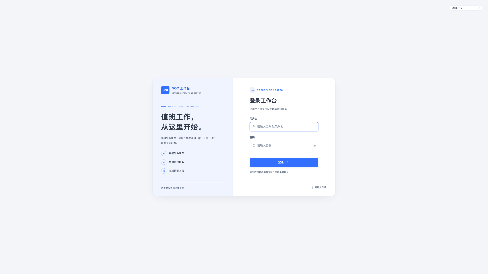

图 2-1：① 输入工作台用户名；② 输入密码，可使用密码框内的显示按钮核对；③ 点击“登录”，也可在输入框中按回车提交。必填项为空或认证失败时，依据页面提示修正。账号被停用或密码被管理员重置后，需要重新登录。

### 2.4 管理员登录界面

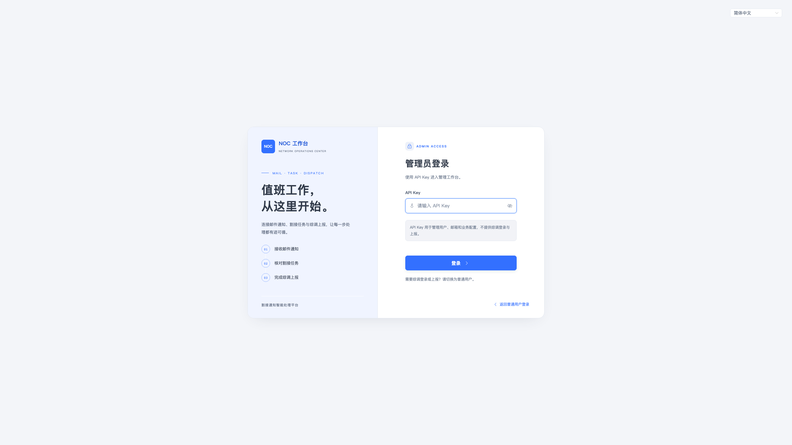

图 2-2：从普通登录页点击“管理员登录”进入。填写 API Key 后登录；需要处理综调上报时，点击“返回普通用户登录”。API Key 不是个人用户的密码，不能填在普通用户密码框里。

### 2.5 页面位置、收起菜单和手册入口

左侧菜单用于切换业务模块；顶部面包屑显示当前位置，详情页可通过上一级入口返回列表。菜单收起后以图标显示，可悬停查看名称。手册入口固定在侧栏底部、账号信息上方，打开新标签页不会替换正在处理的任务。

列表进入详情后返回，割接列表保留原来的查询、分页等状态，便于连续处理。编辑页里的“取消”“返回列表”不等于保存；看到未保存修改提示时，应先保存，或明确选择放弃。工作台退出登录与综调会话退出是不同操作，应按界面提示处理仍在队列中的任务。

### 2.6 权限对照与受限状态

| 功能 | 普通用户仅查看邮箱 | 普通用户可操作邮箱 | 管理员 |
| --- | --- | --- | --- |
| 邮件、详情、附件和任务读取 | 仅授权邮箱 | 仅授权邮箱 | 管理范围内查看 |
| 修改识别、绑定、任务确认、回复、删除 | 不可操作 | 可操作授权邮箱 | 可管理业务数据 |
| 个人综调登录、上报 | 登录可用，不能上报只读邮箱任务 | 可以 | 不提供 |
| 运营统计 | 只读邮箱不纳入其统计范围 | 有操作权限的邮箱 | 全局范围，可含历史邮箱 |
| 供应商、线路、系统配置 | 可维护共享业务配置，样本仍受权限限制 | 同左 | 可以 |
| 邮箱和用户授权管理 | 不可进入 | 不可进入 | 可以 |

某个按钮不可点击时，先检查邮箱权限、任务是否执行中、页面是否正在加载、必填项是否完整。重新登录不会自动增加邮箱权限。

## 3. 查找邮件与核对识别结果

### 3.1 查找待处理邮件

进入“割接任务”，通过邮箱、状态、供应商和关键词等条件定位邮件；“更多筛选”提供额外筛选项。列表显示收发邮箱、阅读状态、处理标签及任务情况，点击目标邮件进入详情。

可使用“标为已读 / 标为未读”调整工作台中的阅读状态。阅读状态不代表任务完成，处理进度仍应查看回复与上报记录。

“邮件记录”没有单独的侧栏菜单，可通过值班概览中的“今日来信”入口或工作台同一地址下的 `/admin/emails` 查看。

### 3.2 邮件详情的处理顺序

已配置供应商邮件的详情分为“邮件核对”“线路确认”“回复审核”“上报处理”和“处理记录”。“当前待办”提供需要处理项目的快捷入口；“高级信息”用于查看更详细的原始信息。

1. 在“邮件核对”查看原文、附件和识别结果。正文为空时优先查看附件；在其他页签也可以点击“邮件原文”查看。
2. 逐项核对运营商单号、开始与结束时间、备用时间、来源时区、地点、原因和线路信息。任务填报的割接窗口以页面标注的北京时间为准，不能直接把来源当地时间当作北京时间。
3. 识别错误时点击“编辑识别结果”，修正后点击“保存并重新匹配”。这只修正当前邮件，不会修改供应商后续识别规则。
4. 保存识别结果会清除已有手动线路绑定，并重新匹配线路；已有填报任务不会自动更新。如需采用新结果，继续到“线路确认”重新生成任务。

时间修改不会自动重新判定历史回复场景，也不会重发回复。任务上报期间不能修改提取结果或线路绑定。

### 3.3 特殊标签与解析异常

| 提示 | 处理方式 |
| --- | --- |
| 线路待确认 | 查看未匹配、多条匹配或缺少 Circuit ID 的线路，人工确认唯一线路或绑定编号 |
| 待确认回复 | 进入“回复审核”，检查收件人、抄送与正文 |
| 时间待核实 | 对照原文和来源时区核实时间，不能仅凭分析结果继续处理 |
| 解析失败 | 查看失败原因，处理配置或服务问题后点击“重新解析” |
| 重复邮件 · 已忽略 | 系统识别为重复内容，不再转发或生成任务；查找较早的原邮件处理 |
| 命中特殊规则 | 查看规则和处理记录，按页面提示判断后续操作 |
| 紧急割接 / 重保期割接 | 检查回复与任务两个部分；即使已回复拒绝，仍可能保留上报任务 |
| 已在割接窗口内 | 查看回复和关闭情况，此类拒绝场景不生成上报任务 |

未配置供应商的邮件主要显示分类、整体时间分析和回复审核，不显示完整的线路上报流程。可从详情进入对应供应商草稿审核。

### 3.4 列表字段、筛选与分页

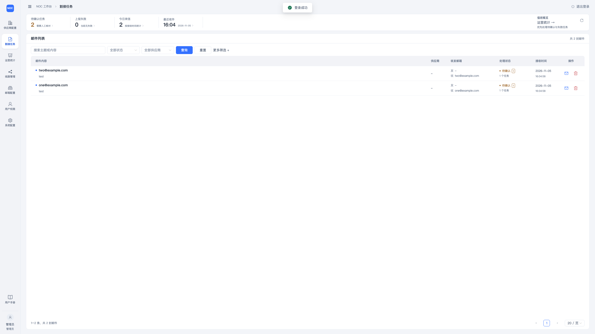

图 3-1：顶部概览提供待确认任务、上报失败、今日来信和最近收件信息。列表按邮件组织，一封邮件可以关联多个任务；“任务数”和“邮件数”含义不同。邮件内容、供应商、收发邮箱、处理状态和接收时间帮助定位目标。蓝色阅读标记及字体表现用于区分未读；处理状态仍要单独查看。

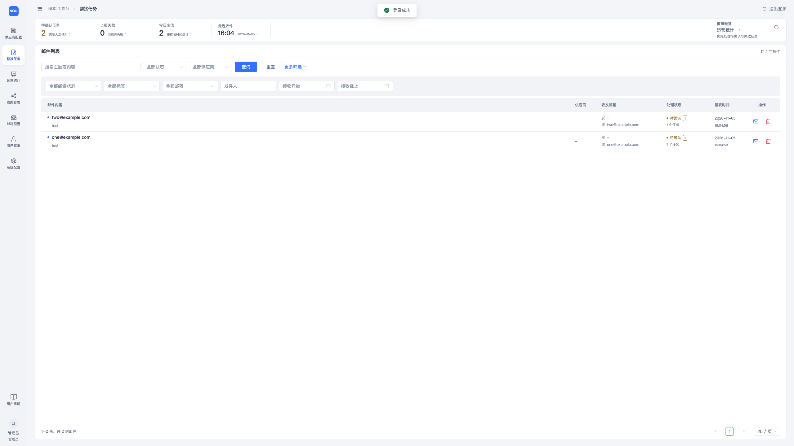

图 3-2：主筛选区包括“搜索主题或内容”、处理状态、供应商。“更多筛选”展开阅读状态、标签、接收邮箱、发件人、接收开始和接收截止日期。按以下顺序使用：

1. 先限定收件邮箱，避免相同发件人或相似主题在不同邮箱之间混淆。
2. 输入关键词或选择状态、供应商，需要时补充日期和标签。
3. 点击“查询”（关键词输入框内也可回车）；折叠筛选区不等于清空条件，按钮上的数量提示表示仍有附加筛选。
4. 没有结果时逐步放宽条件；点击“重置”恢复默认查询。
5. 用列表底部页码及每页条数查看其他结果；不要仅凭当前页判断没有其他待办。

列表行内的阅读图标用于切换已读/未读，删除图标用于删除邮件及关联数据；点击邮件行进入详情。执行前看清当前行主题，尤其是同一供应商连续发送的变更通知。

### 3.5 邮件核对界面与识别修正

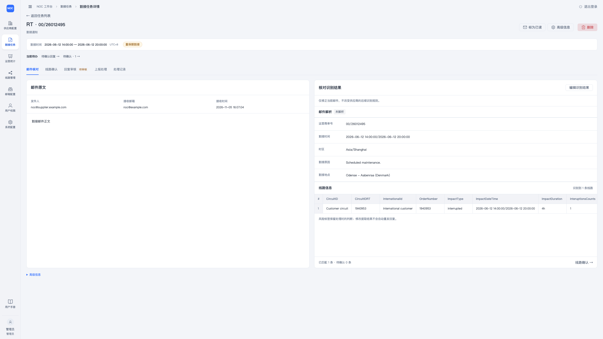

图 3-3：左侧是发件人、收件人、主题及原文/附件；右侧是识别结果和每条线路的数据。左右区域可独立滚动，长邮件不需要离开当前详情页。顶部“当前待办”能跳到仍需要处理的页签。

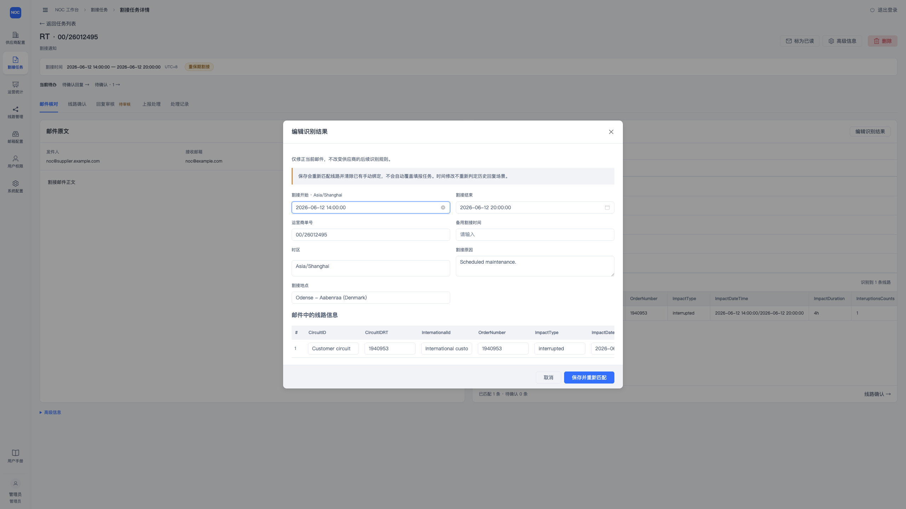

图 3-4：点击“编辑识别结果”进入。核对开始、结束、备用时间和时区，编辑原因、地点及逐行线路编号。保留编号前导零和原有标点；结束时间必须晚于开始时间。复杂结构未显示为普通输入框时，保留其原值，并在高级信息中核查。

点击“保存并重新匹配”后，应看到更新后的结果和新的匹配状态。该操作会清除旧手动绑定，**不会替换已经生成的任务内容**。若需采用修正后的数据，继续绑定线路并重新生成。取消弹窗则放弃本次尚未保存的输入。

### 3.6 附件预览、工作表切换与下载

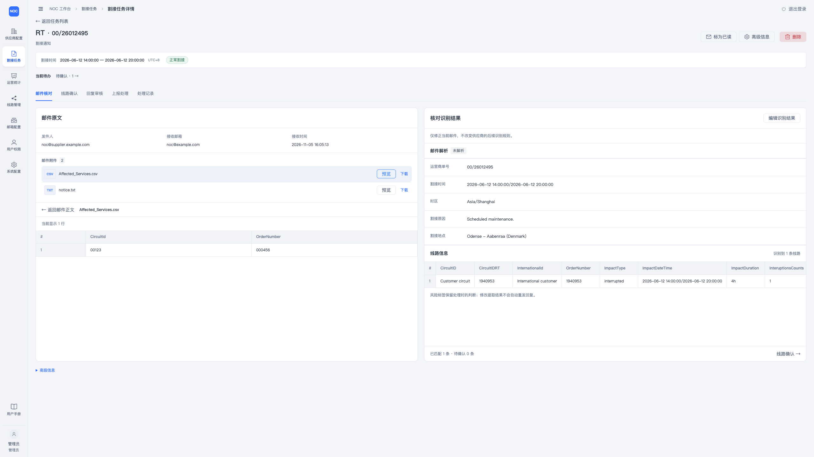

图 3-5：附件行提供“预览”和“下载”。预览在左侧原文区域展示，右侧识别结果仍可对照。根据文件格式显示文本、表格、文档、图片或 PDF；电子表格含多个工作表时，可切换工作表。表格较宽时使用预览区横向滚动。

- 点击另一份附件可切换预览；点击“返回邮件正文”返回原文。
- 显示“当前显示部分内容”时，预览不是完整文件，请下载原文件核对全部行。
- 预览失败时点击“重新预览”，或下载后使用本地软件查看；不支持的文件格式也应下载查看。
- 预览为空不代表邮件没有影响线路，还应检查其他附件、正文和识别结果。
- 附件访问服从来源邮箱权限。无权或已清理的文件不能通过换链接绕过权限。

### 3.7 高级信息与处理记录

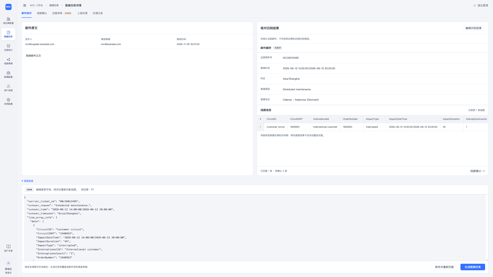

图 3-6：“高级信息”打开邮件核对页里的展开区域，用于查看或编辑原始提取 JSON。只在需要处理复杂字段时使用。JSON 必须是对象，注意引号、逗号和数组结构；保存后仍会重新匹配线路，现有任务仍需显式重新生成。不熟悉结构时优先使用“编辑识别结果”表单。

该区域的“保存并重新匹配”只更新识别及匹配；“生成割接任务”会继续进入任务生成流程。点击后应阅读覆盖现有草稿的确认提示，不要把两个按钮当作同一个保存动作。

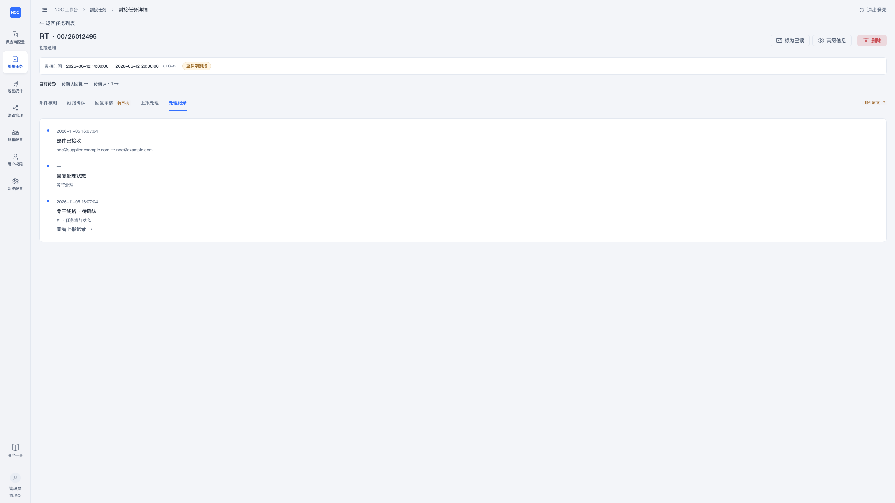

图 3-7：“处理记录”按邮件接收、解析、回复、任务和上报等阶段汇集信息。用它确认动作是否真正完成以及发生时间。详情中的任务状态是当前状态，上报记录是历史尝试，两者应结合查看。

### 3.8 独立邮件记录页

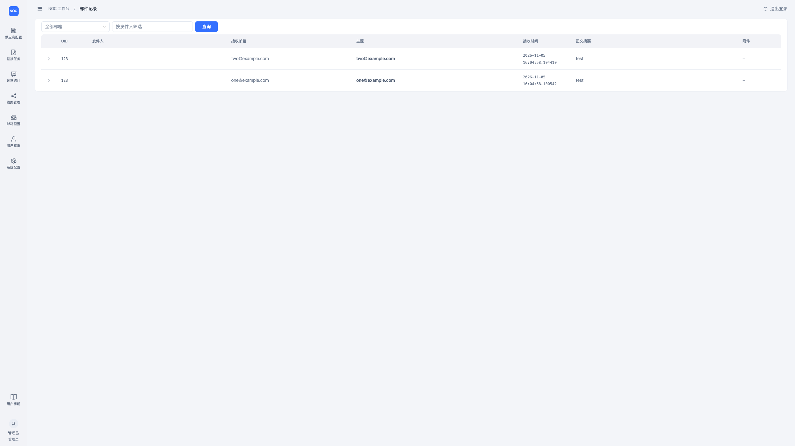

图 3-8：从概览“今日来信”或 `/admin/emails` 进入。可按发件人和接收邮箱查询，查看 UID、主题、正文摘要、附件及接收时间。该页用于核查收件事实，不替代割接详情中的完整业务处理。不同邮箱可能存在相同 IMAP UID，定位问题时优先提供工作台的邮件记录 ID 和收件邮箱。

### 3.9 未配置供应商的时间分析

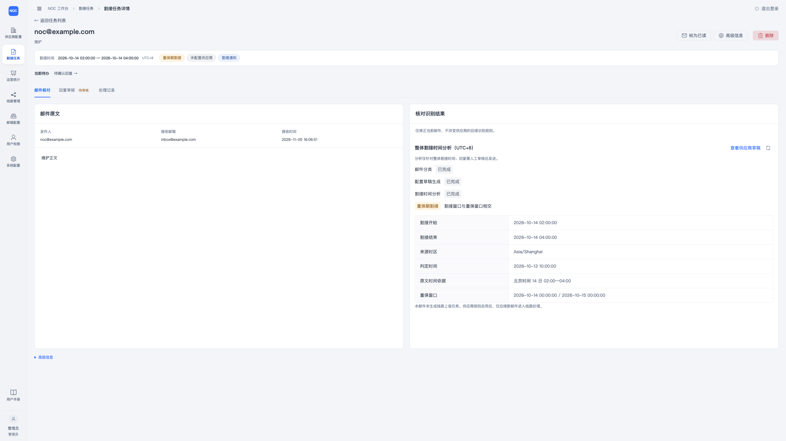

图 3-9：未配置供应商邮件先展示分类、整体时间及场景分析，核对开始/结束时间、来源时区、原文依据、判定时间和重保窗口。状态可能为等待处理、处理中、已完成、失败或时间待核实。分析的是整封邮件的整体窗口，不是逐条线路填报内容。

失败时先查看原因，再按对应失败任务的重试入口处理；“时间待核实”应回原文确认，不能当作分析成功。页面有待审核回复时，到“回复审核”独立确认。通过“查看供应商草稿”进入规则审核；启用规则只让后续新邮件进入正式线路处理，不自动给这封历史邮件补生成任务。

## 4. 确认线路与生成任务

1. 在“线路确认”中查看邮件中的编号、查询关键字、候选 Circuit ID、线路类型和状态。
2. 对零匹配或多条匹配的项目，选择唯一候选线路，或输入完整 Circuit ID，点击“绑定并重新匹配”。
3. 如果该 Circuit ID 尚未录入线路台账，选择正确的客户或骨干类型后绑定。已在台账维护的线路以台账类型为准；清空手动绑定可恢复自动匹配。
4. 检查“状态不允许生成”等提示。线路台账中只有状态为“正常”的线路会生成割接任务。
5. 确认识别结果和线路绑定均已保存后，点击“生成割接任务”或“重新生成割接任务”。系统按客户、骨干类型分别生成相应任务。

> 重新生成会替换这封邮件已有的填报内容，包括人工修改，并重置为待确认。应先核对影响范围，再在确认框中继续。

生成完成后进入“上报处理”，确认任务类型、线路数量和割接窗口是否符合预期。仅保存线路匹配结果不等于已有任务采用了新结果。

### 4.1 自动匹配、人工绑定与状态拦截

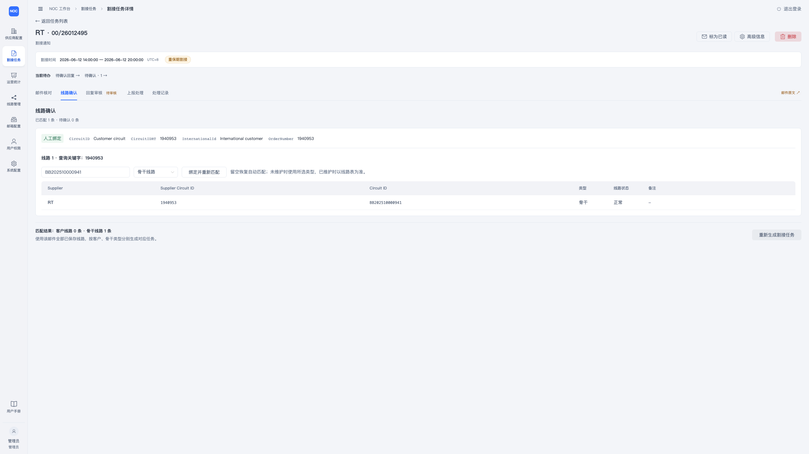

图 4-1：每组匹配结果对应邮件中的一条线路信息。先看邮件编号与查询关键字，再看候选内部线路，不要只按相似名称选择。

| 结果 | 如何操作 | 操作后的检查 |
| --- | --- | --- |
| 已匹配且唯一 | 核对 Circuit ID、客户/骨干类型与状态 | 与原邮件影响线路一致 |
| 多条匹配 | 进入编辑，选择唯一候选；必要时在台账查清归属 | 保存后显示明确绑定 |
| 未匹配 | 检查识别编号，再输入完整内部 Circuit ID | 台账未维护时明确选择类型 |
| 人工绑定 | 检查绑定编号；修改后重新保存 | 确认当前绑定与任务类型一致 |
| 状态不允许生成 | 查看台账实际状态及备注 | 仅在业务事实确实变化时维护状态 |

“编辑线路匹配结果”进入可编辑状态，“取消编辑线路匹配”退出当前编辑。输入值未保存时不能直接重新生成；先点击“绑定并重新匹配”。清空绑定后保存会恢复自动匹配，可能重新出现零匹配或多匹配。

### 4.2 生成前后各检查一次

生成前查看客户线路数、骨干线路数、仍待确认的线路和未保存修改提示。生成使用这封邮件**全部已保存线路**，不是只使用当前展开的一行。

生成后查看“上报处理”中的任务类型和数量，再打开每个任务核对实际行数。重新生成会覆盖人工填报修改并重置草稿，因此“修正识别 → 保存并重新匹配 → 检查或重设绑定 → 重新生成 → 核对 → 人工确认”应按顺序完成。

对已上报过的邮件，先核对已有综调记录和本地历史，再决定是否需要新一轮生成或上报。重新生成草稿不等于撤销外部综调工单。

## 5. 审核与发送回复

1. 打开邮件详情的“回复审核”。没有待审核回复时，页面会显示相应提示。
2. 核对收件人；如需多个收件人，输入邮箱后按回车添加。根据需要调整抄送，留空则不抄送。
3. 核对回复正文及其对应的割接场景，确认时间、原因和业务结论准确。
4. 点击“确认发送”，在弹出的确认框中核对全部收件人与抄送地址后再确认。
5. 等待“邮件回复已发送”等明确成功提示，并查看处理记录。无需回复时，可点击“放弃回复”并确认。

放弃回复不会发送邮件，也不会写入该待确认回复的割接场景。供应商配置中可指定回复邮箱；留空时使用来信发件地址，发送前仍应核对实际收件人。

如果显示“发送结果待核对”，请先检查发件箱和实际发送结果，再决定如何处理，避免重复发送。

### 5.1 回复审核界面各项说明

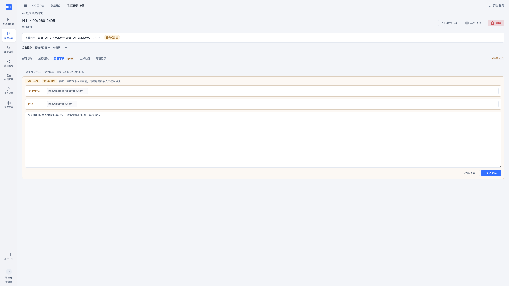

图 5-1：收件人和抄送支持多个地址，输入完整邮箱后回车形成一项，可移除错误项。至少保留一个有效收件人，抄送可留空；格式错误或正文为空时不能发送。核对正文中的日期、窗口、拒绝原因和需要对方配合的动作，不要只检查语气。

| 操作 | 是否发信 | 是否完成其他流程 |
| --- | --- | --- |
| 修改收件人、抄送、正文 | 不会立即发送 | 不会更新填报任务 |
| 点击“确认发送”并通过二次确认 | 执行发送 | 不代表已完成综调上报 |
| 在确认框取消 | 不发送 | 返回草稿继续核对 |
| “放弃回复”并确认 | 不发送 | 放弃待审核回复，不替代任务核对 |

切换页签后仍应检查草稿内容；刷新、返回列表前不要把未提交输入当作已保存。发送错误时查看具体原因，例如 SMTP 配置、收件地址或权限问题；发送状态不确定时先检查发件箱，不能仅因页面没有成功提示就反复发送。

## 6. 综调登录、上报与异常处理

### 6.1 建立综调会话

1. 使用普通用户账号，进入“综调会话”。
2. 选择“测试环境”或“正式环境”，核对显示的登录地址。显示“未配置”的环境不能使用，请联系管理员配置。
3. 选择登录方式。密码登录需输入账号、密码和图形验证码；手机验证码登录按页面要求填写手机号、密码、图形验证码，并获取和填写手机验证码。
4. 点击“登录并建立会话”，等待登录成功；使用“立即检测”确认会话状态为有效。

登录信息仅用于本次综调登录，不写入业务数据库或运行日志。新环境登录成功会使原环境会话失效；上报使用当前选择的环境。队列未结束时，系统会限制退出或切换综调账号。

### 6.2 核对填报内容

在“上报处理”点击“核对任务”，展开“完整填报内容”，检查校验提示。

| 任务类型 | 核对内容 | 提交方式 |
| --- | --- | --- |
| 客户线路 | 电路表、割接原因表、线路编号、保护情况、影响时长、时间和原因 | 保存时生成 Excel；可“下载客户线路 Excel”复核，上报时自动导入综调 |
| 骨干线路 | 每条线路的表单分组、标题、时间、中断类型及分钟数、人员信息和附件 | 自动逐项填写综调表单并上传关联邮件附件 |

修改后点击“保存修改”，任务会回退为“待确认”。修正校验提示并检查线路是否完整，再点击“人工确认”。一封邮件存在客户和骨干任务时，需分别核对和确认。

### 6.3 提交与跟进

1. 确认当前综调环境、账号和有效会话。
2. 对已确认任务点击“上报综调系统”。会话无效时按提示进入“综调会话”重新登录。
3. 查看“综调上报进度”。同一工作台用户的多个任务按提交顺序排队，无需重复点击；不同用户的队列可以并行处理。
4. 关闭进度面板不会中断后台上报，可从“上报记录”再次打开。
5. 查看最终状态、综调任务号、说明和操作截图。点击截图可放大并切换步骤。

### 6.4 理解状态并采取行动

| 状态 | 含义与下一步 |
| --- | --- |
| 待确认 | 核对并保存完整填报内容，再人工确认 |
| 已确认 | 已通过人工确认，可以提交上报 |
| 排队中 | 等待同一用户前面的任务完成，无需重复提交 |
| 执行中 / 上报中 | 后台正在操作综调，查看进度并等待结果 |
| 已暂停 | 尚未执行的任务被手动暂停；点击“继续上报”恢复 |
| 等待重新登录 | 登录失效导致队列暂停；用原综调账号和环境重新登录后自动恢复 |
| 结果待核对 | 可能已经提交，系统不能确定结果；先在综调核对实际记录，再处理本地状态 |
| 已成功 / 已上报 | 查看成功记录、任务号和截图，确认本次处理完成 |
| 需处理 / 上报失败 | 查看错误及截图，修正问题后按提示重新确认或上报 |

“暂停任务”适用于尚未执行的任务，不用于强行中止正在提交的任务。手动暂停会保留到重新登录和服务重启之后，需自行点击“继续上报”。普通上报失败不会阻塞后续任务；登录失效则会暂停该用户队列。

对“结果待核对”，先到综调确认是否已生成记录、是否存在部分成功，再选择“核对后标记成功”或“核对后标记失败”。这两个操作只修正本地记录；标记失败后允许重新上报，不能在未确认实际结果时直接重报。

如出现未识别弹窗或需人工干预提示，查看操作截图，并按值班流程人工处理。

### 6.5 综调会话页的日常使用

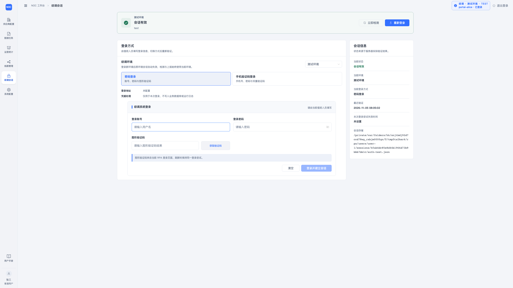

图 6-1：先看环境选择及登录地址，再看当前会话信息。顶部全局状态和本页均用于确认当前账号、登录方式、最近验证时间。点击“立即检测”取得服务端验证结果；需要重新认证时使用“重新登录”。

密码方式的图形验证码来自当前服务器登录页面；刷新验证码后应使用新图输入。手机方式还需通过“获取验证码”取得手机验证码，重发后使用最新有效验证码。点击“清空”仅清理当前表单输入，不表示综调账号已退出。按页面显示处理登录尝试过期或环境未配置的问题，不要自行切换到其他环境代替本次上报。

队列尚未结束时退出/切换可能被阻止，应先处理队列。因失效暂停的任务需原账号、原环境恢复；手动暂停的任务则需要自己点击“继续上报”。

### 6.6 上报处理总览与任务详情

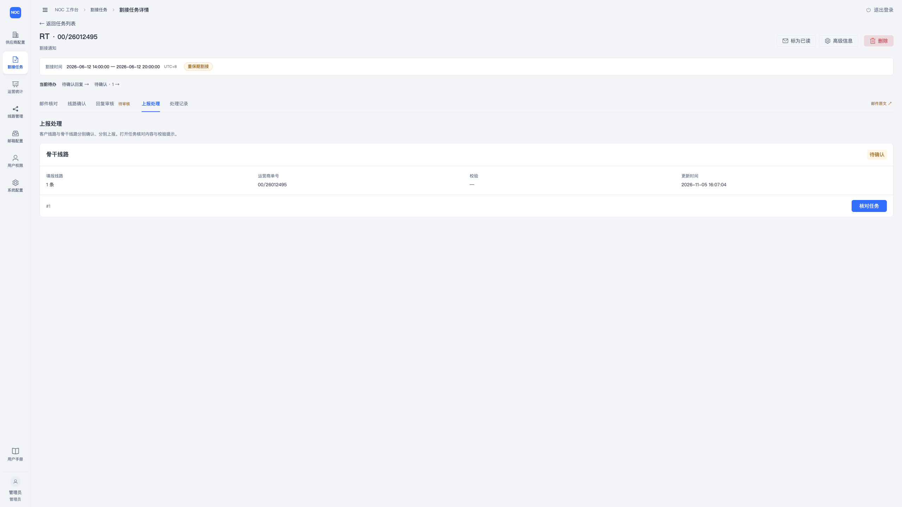

图 6-2：“核对任务”打开完整任务，“查看上报记录”定位历史记录与截图。每个任务显示类型、状态、线路数和校验提示；同一邮件有两类任务时，两者都需要单独确认和上报。

任务详情里的“完整填报内容”可展开/收起。收起表单只是改变显示，不保存、不确认。查看任务时先核对已保存的上报摘要，再展开修改明细；离开仍有未保存内容的任务时，按提示保存或明确放弃。

### 6.7 客户线路表单逐项操作

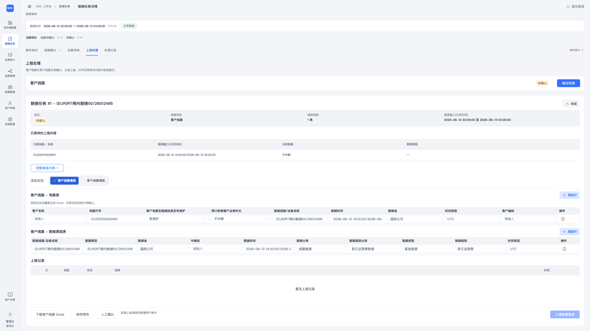

图 6-3：客户任务含“电路表”和“割接原因表”。表格字段较多，可横向滚动查看全部列。

1. 在电路表核对内部电路代号、割接窗口、保护情况、预计影响及其他必填字段。
2. 在割接原因表核对割接原因、类型、地点和窗口；两张表应描述同一任务。
3. 保护情况、影响时长等枚举字段从下拉选项选择。根据实际业务选择“有保护 / 无保护”“不中断 / 瞬断”等，不以通过校验为目的随意选择。
4. “添加行”添加一条可编辑记录；存在行时可能复制最后一行的当前内容，新增后务必修改编号及其他不同字段，避免复制出重复线路。没有行时使用默认结构，需要补齐必填值。
5. 使用行内删除移除不应填报的行。不能把需要上报的线路删空后继续确认。
6. “保存修改”重新生成 Excel 并回到待确认；“下载客户线路 Excel”用于核查已经保存的版本，未保存的输入不会包含在下载文件中。
7. 查看校验提示并修正，再“人工确认”。确认是本地审核动作，不会立即提交综调。

### 6.8 骨干线路表单逐项操作

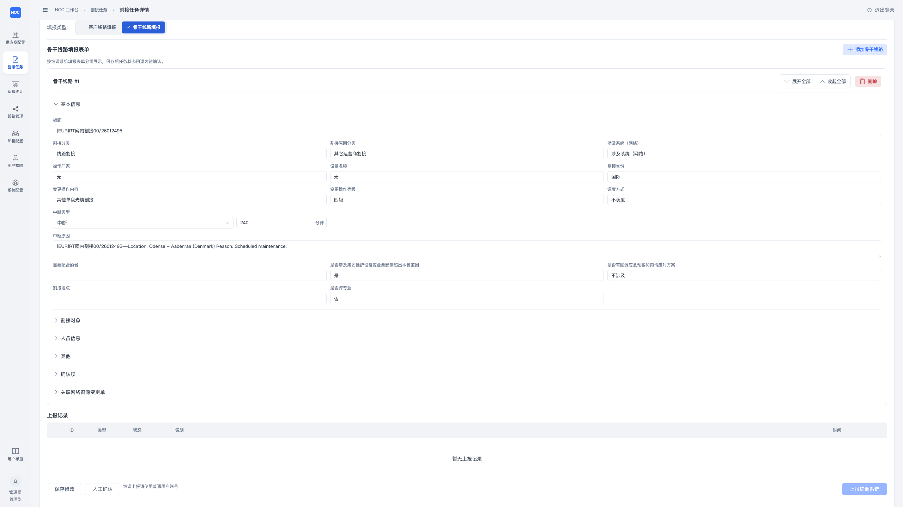

图 6-4：每张卡片对应一条骨干线路；“展开全部 / 收起全部”控制分组显示，“添加骨干线路”新增卡片。已有卡片时，新卡片可能沿用最后一张的输入，添加后逐项核对，不要漏改标题和系统名称。

| 分组或字段 | 核对重点 |
| --- | --- |
| 基本信息 | 标题、割接开始结束、操作等级、厂家、是否中断等 |
| 中断类型与分钟数 | 选择中断时补齐对应中断分钟数；不要把维护总窗口当成单次业务中断时长 |
| 割接对象 | 系统、线路等对象是否覆盖本次实际影响范围 |
| 人员信息 | 联系人员及联系方式是否适用于本次任务；公共默认值来自系统配置 |
| 原因与其他信息 | 地点、原因、备注和确认项是否准确，避免保留上一条线路的内容 |

每张卡片可删除；误删后不要直接保存，应先恢复完整数据。保存会重置为待确认；新增/删除/切换类型之后都需要重新检查校验结果。类型切换会改变填报结构，应先确认线路真实类型，不能把类型切换当作解决校验错误的捷径。

### 6.9 队列、暂停与恢复的界面操作

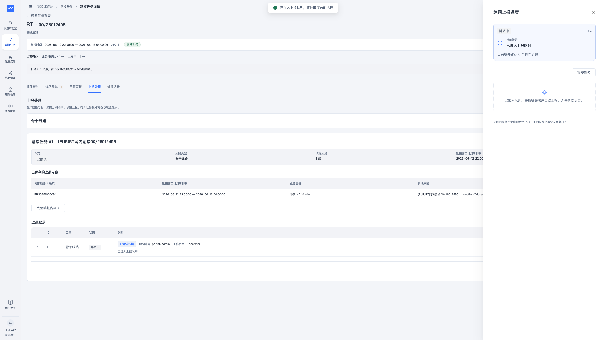

图 6-5：进度面板显示状态、当前阶段和已记录步骤。排队中代表等待执行，不应重复点击上报。离开页面或关闭面板不会停止后台队列；可以从任务的上报记录重新进入。

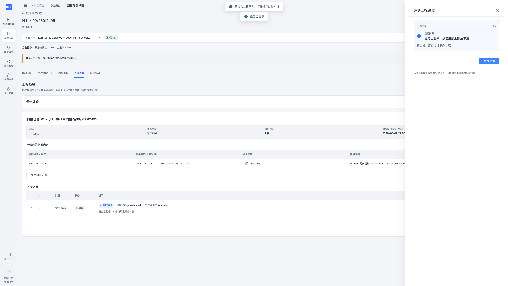

图 6-6：对尚未执行的任务点击“暂停任务”，待页面明确显示“已暂停”后才算完成暂停。点击“继续上报”恢复后，应再次观察排队或执行状态。不要把页面刷新或工作台退出作为停止上报的方法。

### 6.10 上报记录、截图与人工核对结果

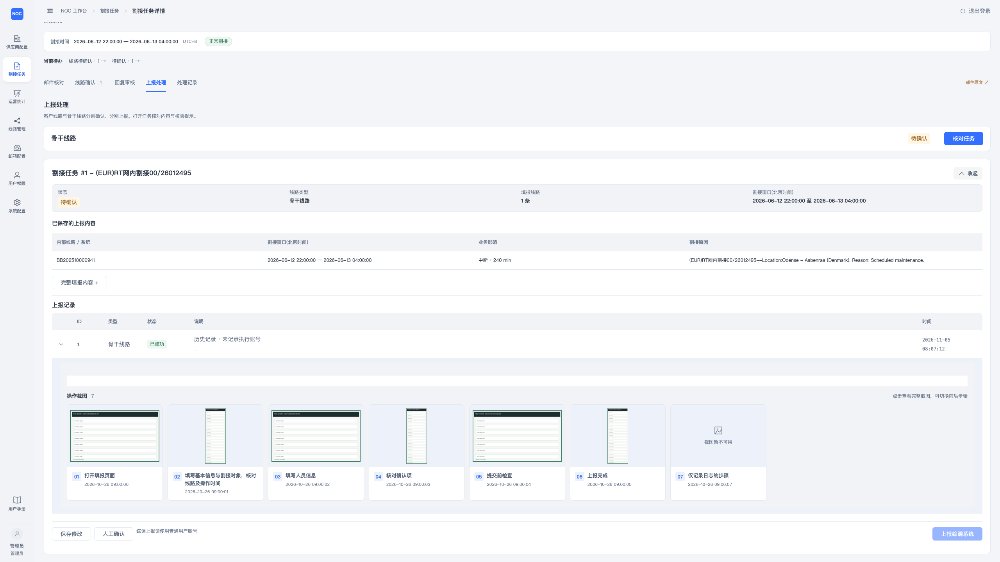

图 6-7：示例步骤截图来自隔离测试页面，用于说明记录展开与大图入口；并非真实综调提交凭证。

“上报记录”保留每次尝试的状态、说明、综调任务号和操作过程。展开记录后可查看步骤截图；点击缩略图看大图，使用前后切换或方向键查看相邻步骤。截图缺失时结合文字记录与综调实际页面判断，不能将“没有截图”视为“没有提交”。

对于“结果待核对”，记录可能已经提交或只完成部分线路。先根据任务号、标题、时间及线路在综调逐项核实：全部成功才选择“核对后标记成功”；确认未成功并可安全重试，才“核对后标记失败”。弹窗说明强调此操作只修正本地记录，不会删除、补齐或撤销外部工单。

### 6.11 常见上报阻断及处理顺序

| 阻断 | 检查与处理 |
| --- | --- |
| 未人工确认 | 先保存修改、处理校验项，再人工确认 |
| 无操作权限或管理员身份 | 切换为具有目标邮箱操作权限的普通用户 |
| 会话无效 | 回综调会话用原账号及环境重新认证 |
| 同一任务已经在队列中 | 打开该次进度跟进，不再创建重复尝试 |
| 表单默认结构未加载 | 按提示刷新或重试；持续失败联系维护人员 |
| 上报进度暂时读取失败 | 系统会重试读取，先查看记录；不能据此判断后台已停止 |
| 未识别弹窗、部分成功、服务中断 | 查看截图和实际综调结果，按人工核对流程处理 |

## 7. 维护供应商规则与配置草稿

### 7.1 新建或修改正式配置

1. 进入“供应商配置”的“正式配置”，点击“新增供应商”或编辑已有供应商。
2. 填写供应商名称、发件邮箱与回复邮箱，核对通知样本及其他邮件分类样本。可按页面入口导入 EML 或填写样本。
3. 检查割接时间、时区、原因、地点等提取规则；为线路信息添加邮件实际使用的编号字段，选择用于查询线路的关键字。
4. 在“测试提取效果”中测试当前样本，并对照原文核对结果。先检查样本下方实际列出的附件：有来源关联的样本可带入有权限的来源附件，导入 EML 可带入附件；缺少时手动添加。
5. 修改样本或规则后重新测试，确认分类、时间、线路编号均正确，再保存配置。

测试提取会调用识别服务，但不会保存配置或发送邮件。规则保存后用于后续来信；当前邮件的“编辑识别结果”不会同步修改供应商规则。

如果样本提示未获来源邮箱授权，其正文与附件会隐藏；可维护其他共享配置，如需查看或测试该样本，请联系管理员获得来源邮箱权限。

### 7.2 审核自动生成的草稿

1. 进入“配置草稿”，查看“收集样本中”“生成中”“待审核”或“生成失败”等状态。
2. 打开“审核配置”，检查样本、生成依据、AI 提醒核对的事项以及提取规则。
3. 补齐供应商名称等信息，测试并核对提取效果。“保存草稿”仅保存修改，不启用正式规则。
4. 核对完成后点击“确认启用”。启用后的记录保留在“已启用记录”，该发件人的后续新邮件开始使用正式配置。

未配置时期的历史邮件不会因为启用规则而自动补生成线路上报任务。生成失败可检查原因后“重试失败任务”。

“不是供应商邮件”会把该发件人加入排除名单并移除草稿，后续未配置邮件不再进行相应分类、草稿生成或时间分析。“删除配置草稿”保留原邮件、分析结果和已启用配置；自动发现开启时，后续新邮件可能重新生成草稿。

删除正式供应商会同时移除其提取字段配置，确认前应核对是否仍需处理该供应商的来信。

### 7.3 正式配置列表与新建入口

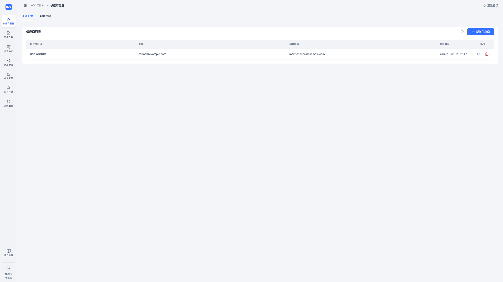

图 7-1：“正式配置”与“配置草稿”是两个入口。正式配置用于已经启用的规则，编辑保存后用于后续邮件；配置草稿需经过“确认启用”才进入正式处理。删除正式配置会同时删除其字段规则，应核对名称与来信地址后再确认。

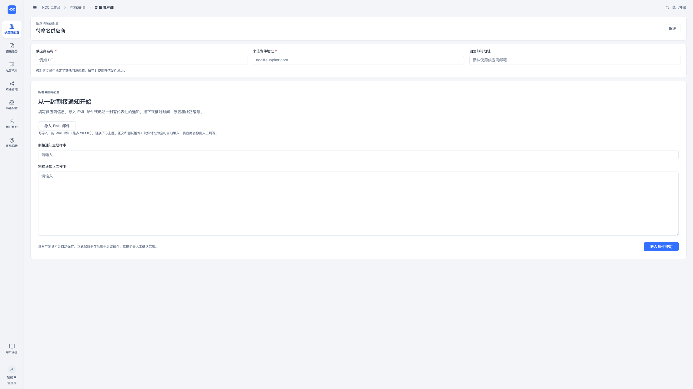

图 7-2：点击“新增供应商”后，填写供应商名称、来信发件地址、回复邮箱，以及一封有代表性的割接通知。名称由人工填写，来信地址用于匹配后续发件人，回复邮箱为空时使用原发件地址。填完后点击“进入邮件核对”，不会在这一步自动启用或保存。

| 基础信息 | 填写要求 | 示例 |
| --- | --- | --- |
| 供应商名称 | 便于值班人员识别的业务名称 | 示例国际网络 |
| 来信发件地址 | 实际通知使用的完整邮箱，避免将联系人或抄送地址误填为发件地址 | noc@example.com |
| 回复邮箱 | 通知明确指定的回复地址；未指定可留空 | maintenance@example.com |
| 割接通知主题 | 完整的代表性通知主题 | 计划维护通知 · DEMO-2026-001 |
| 割接通知正文 | 包含窗口、时区、原因和线路信息的原文 | 保留表格及字段标签 |

### 7.4 导入 EML、编辑样本与来源邮件

“导入 EML 邮件”接受不超过 20 MB 的 `.eml` 文件。导入会替换当前主题、正文及测试附件；发件地址为空时才自动填入，供应商名称仍需人工填写。导入完成后检查附件数量与跳过的 ICS 日历附件提示，不能只看文件已选择就继续保存。

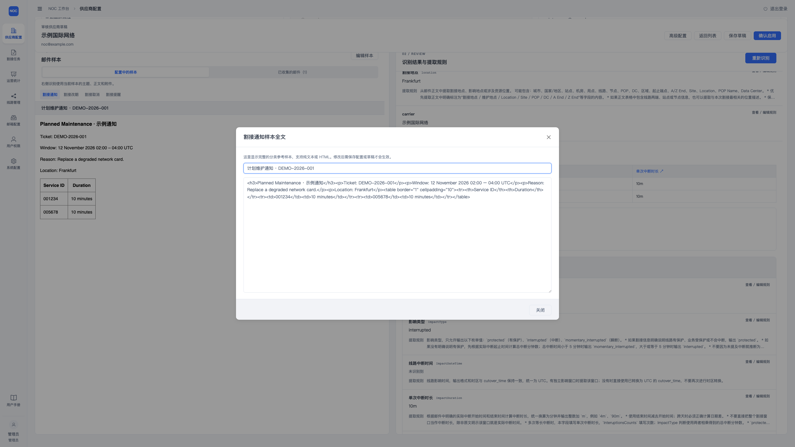

图 7-3：“编辑样本”或高级配置中的“展开编辑”打开完整主题和正文。关闭弹窗只回到页面，不代表服务器已保存；还需点击页面的“保存配置”或“保存草稿”。正文支持保留邮件 HTML 结构，优先保留表格、列名与原始编号。

草稿中可在“配置中的样本”和“已收集的邮件”之间切换，通过样本选择框及分页检查不同来信。对已收集邮件执行识别，用于验证规则是否适用于实际来信；需要正式采用时，点击“设为此分类样本”，再保存。仅切换查看某封邮件不会自动覆盖配置样本。已启用记录以查看历史依据为主，不应当作可随意修改的待审核草稿。

“查看来源邮件”“载入原邮件”用于对照或恢复原文，恢复后仍需保存才能写入配置。样本来源无权限时，正文及附件会被隐藏，识别按钮可能不可用；其他共享字段仍可维护。

### 7.5 邮件核对与识别结果

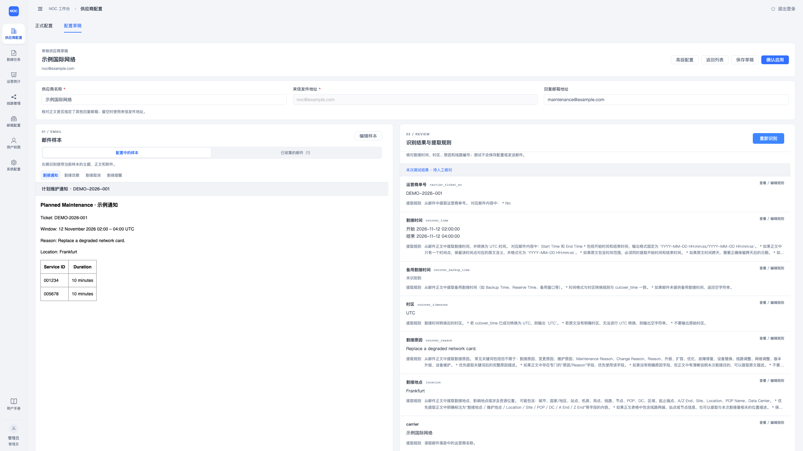

图 7-4：左侧检查当前样本和附件，右侧检查单号、时间、原因、地点、线路及查询编号。选择“割接通知”样本后点击“识别这封邮件”，已有结果时点击“重新识别”。其他邮件分类样本用于分类识别，不用于测试割接字段提取。

- “待人工核对”表示测试完成，不表示规则已经准确。
- “未识别到”应回原文确认是否确有该值；有值但未识别，修改规则后重试；原文没有的值不要凭经验编造。
- “上次结果”或“规则已修改”说明当前显示的结果可能使用旧样本/旧规则生成，需重新识别。
- “查看完整返回内容”展开原始响应，适合核查未在摘要里展示的字段或识别异常。
- 测试失败时先看错误，先前结果仅供参考，不能作为当前规则测试通过的证明。

当前来源附件及手动上传附件会参与识别。以页面实际附件列表为准；可以预览、下载来源附件，手动添加的测试文件可移除。切换样本或来源时需重新检查附件范围，避免把不同邮件的附件混在一起。ICS 日历附件不参与识别。

### 7.6 查看、修改和应用识别规则

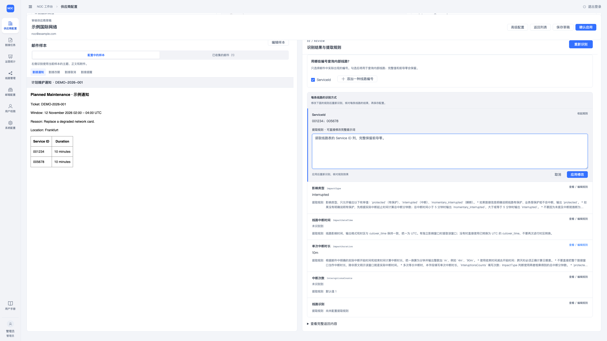

图 7-5：勾选哪些编号用于内部线路查询；“查看 / 编辑规则”打开对应字段的规则编辑器。固定信息、每条线路的影响字段和自定义编号均有各自规则入口。

1. 选择要修正的字段，例如 ServiceId、割接原因或中断时长。
2. 阅读完整当前规则，明确应从正文哪一段或附件哪一列取值。
3. 用业务语言修改识别要求，例如“读取表格 Service ID 列，保持字符串，保留前导零；同一行只归属于一条线路；没有明确值返回空字符串”。
4. 点击“应用修改”，随后“重新识别”，对照实际输出核对。
5. 测试通过后再“保存配置”或“保存草稿”。应用修改只更新当前编辑状态，不等于持久保存。

规则编辑器中有未应用内容时，切换字段、返回或测试可能提示保留/放弃修改；按实际意图选择，不要把弹窗关闭当作已经应用。

### 7.7 添加线路编号与查询关键字

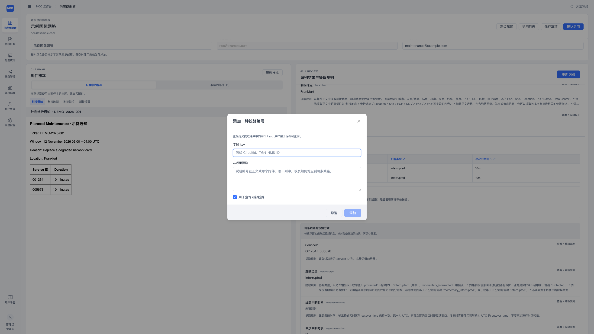

图 7-6：“添加一种线路编号”包含字段 key、从哪里提取、是否用来查询内部线路三项。

| 项目 | 如何填写 |
| --- | --- |
| 字段 key | 使用邮件对应的编号名称，例如 `ServiceId`、`CircuitId`、`OrderNumber`、`TGN_NMS_ID`；大小写和下划线会保留 |
| 从哪里提取 | 描述来源列或段落、每条线路如何对应、前导零和标点如何保留、缺失时如何处理 |
| 用此编号查询线路 | 勾选后参与内部台账查询；不是所有提取字段都必须作为查询关键字 |

字段名只使用字母、数字和下划线，不能与已有字段重复，也不能占用固定字段和 `line_array`、`line_query_keywords` 等保留名称。`CircuitId` 与 `Circuit_ID` 是不同 key，改名后检查后续规则和查询设置是否一致。

不要用维护工单号替代线路编号：一份工单可包含多条线路。多个查询编号应来自同一条线路的同一行，不能把所有编号串成一条虚构线路。

### 7.8 高级配置总览

在编辑页顶部点击“高级配置”，可看到完整的分类样本、固定字段、线路字段、顶层字段、测试和提示词区域。点击“返回邮件核对”回到对照模式。各分区可以展开或收起；收起只隐藏内容，不取消已输入的修改。

| 高级分区 | 作用 | 常见误区 |
| --- | --- | --- |
| 核对邮件样本 | 设置不同类型来信的分类样本 | 把取消通知当成割接通知样本 |
| 割接信息的识别方式 | 覆盖系统内置固定字段的提取规则 | 将待提取的真实值填入规则框 |
| 用于匹配内部线路的信息 | 定义每条线路的自定义编号及查询用途 | 查询关键字选择了不属于线路的工单号 |
| 其他信息（可选） | 提取整封邮件的顶层额外属性 | 误以为它会自动参与线路查询 |
| 测试提取效果 | 补充说明、附件、提示词预览和测试 | 把预览成功当成已经保存配置 |

### 7.9 高级配置：分类样本及自定义分类

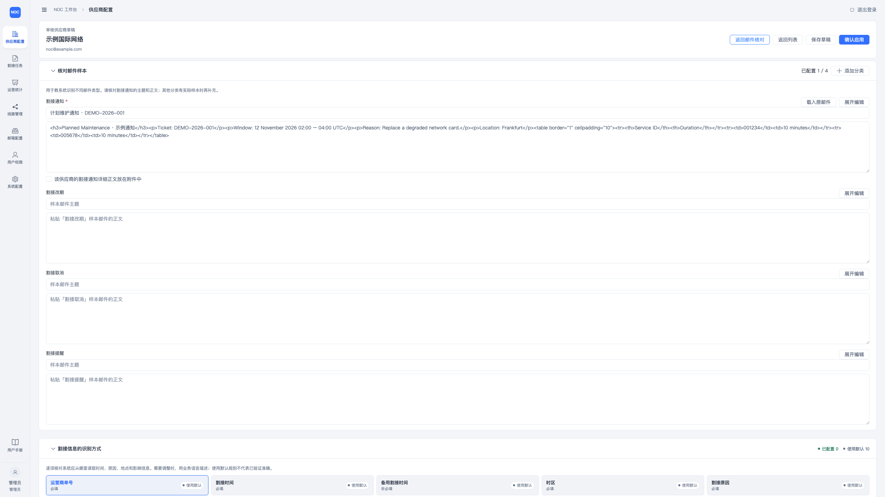

图 7-7：每个分类有主题和正文样本。“割接通知”为必填分类，保存时主题和正文都不能为空。其他分类应填写真实有代表性的样本，无实际样本时不要虚构。

“正文在附件中”等选项用于提示附件是主要内容来源，不能代替上传/关联实际附件。仍需保证通知样本的主题、正文完整，并检查测试附件列表。

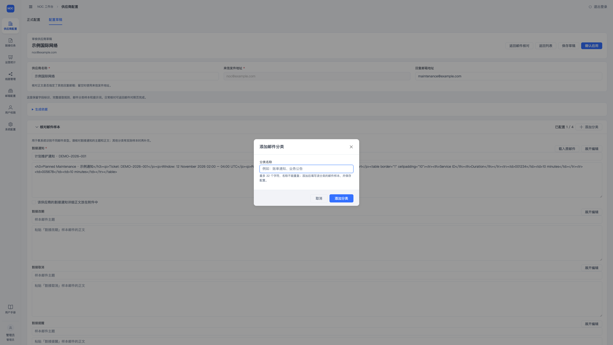

图 7-8：点击“添加分类”，输入 1–32 个字符的明确分类名称并确认；添加后填写其主题和正文样本。名称不能与已有分类重名，不能包含控制字符，也不能使用保留分类名“其它”。系统默认分类不能按自定义分类方式删除，自定义分类可通过删除图标移除；删除前确认后续分类需求。

添加、删除或修改样本后，保存配置才会更新正式规则。分类样本用于辨别邮件类型，填报任务仍取决于邮件被识别为割接通知及后续场景判断。

### 7.10 高级配置：固定字段和恢复默认

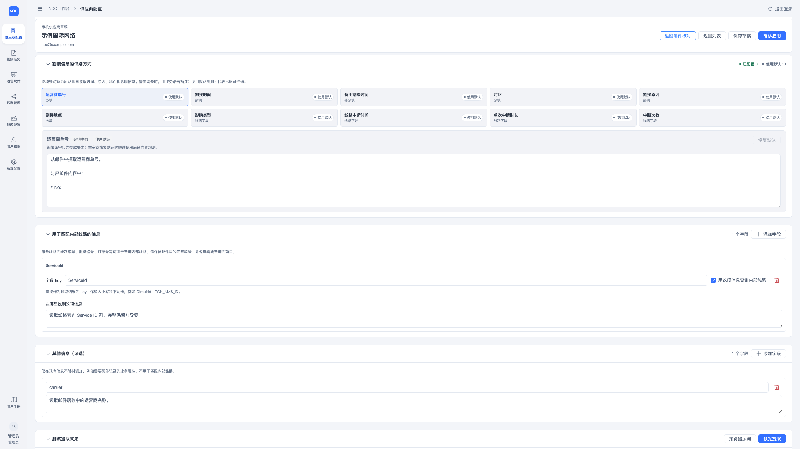

图 7-9：上方选择字段，下方查看规则、必填/线路字段标识和“已配置 / 使用默认”状态。可用方向键在字段间切换。“恢复默认”清除该字段的自定义覆盖，继续使用后台内置规则；留空也使用默认规则。恢复默认后仍要测试并保存。

| 字段 key | 业务含义 | 核对要求 |
| --- | --- | --- |
| `carrier_ticket_no` | 运营商单号 | 从工单号/No 等字段读取，不与每条线路编号混淆 |
| `cutover_time` | 整体割接窗口 | 同时保留起止日期，正确处理跨天；默认规则将明确时区转换为 UTC |
| `cutover_backup_time` | 备用窗口 | 有明确备用时间才提取，不能把主窗口重复填入 |
| `cutover_timezone` | 提取结果的时区 | 默认时间已转 UTC 时为 `UTC`；不能继续填原时区造成再次转换 |
| `cutover_reason` | 割接原因 | 优先 Reason 等明确原因字段，不补充原文不存在的理由 |
| `location` | 地点、站点或节点 | 保留原文名称与缩写，不自行推断缺失城市 |
| `ImpactType` | 每条线路的影响类型 | `protected` 有保护、`interrupted` 中断、`momentary_interrupted` 瞬断 |
| `ImpactDateTime` | 每条线路影响窗口 | 与整体窗口采用一致输出时区，不能重复转换 |
| `ImpactDuration` | 单次中断时长 | 默认使用整数分钟加 `m`，例如 `10m`；不是维护窗口总长 |
| `InteruptionsCounts` | 中断次数 | 默认 1；保留系统已有 key 拼写，不自行改名 |

默认规则中，有明确保护条件时才判为 `protected`。否则依据实际中断窗口与次数判断影响；总中断时间小于 5 分钟为瞬断，大于等于 5 分钟为中断，无法确定则留空等待核对。多次等长中断时，单次时长与次数分开填写。

“规则文本”应描述提取方法，例如“读取 Impact Duration 列，单位为分钟”，不是把 `10m` 固定写成所有邮件的结果。若供应商时间未标注时区，应说明依据或保留待核实，不能静默假设。

### 7.11 高级配置：线路自定义字段

图 7-10：点击“添加字段”新增一行，填写字段 key 和提取要求；勾选“用这项信息查询内部线路”后，该字段加入查询关键字。删除字段会同时影响对应编号的提取和查询，应检查剩余字段是否足够。

这些字段输出在 `line_array` 的每个元素中。例：邮件有两行 Service ID，应产生两条线路对象，各自保留本行的编号与影响信息。线路名称可以作为额外字段提取，是否用于查询取决于台账实际维护方式。

### 7.12 高级配置：顶层其他信息

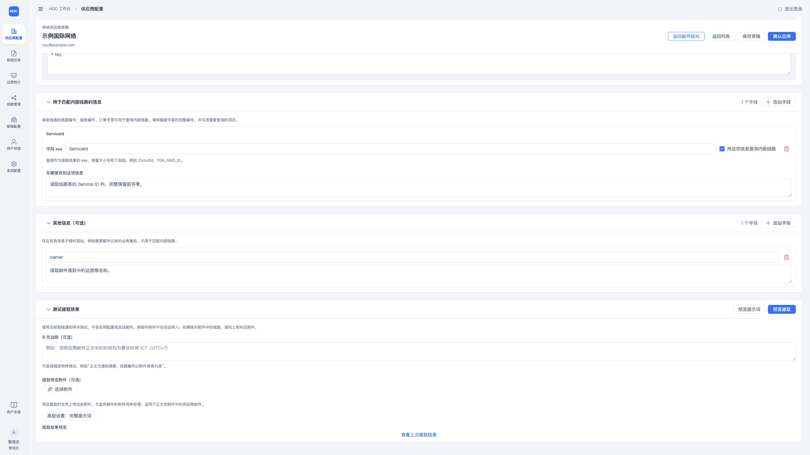

图 7-11：“其他信息（可选）”用来提取整封邮件的属性，例如 `carrier`。点击“添加字段”，填写 key 和含义/来源；不需要时删除。它输出在结果顶层，不放在每条线路内，也不会自动成为线路查询关键字。

字段名称避免与固定字段、线路结构字段冲突。新增顶层字段只是增加提取数据，并不会自动新增页面按钮、业务判断或上报列；是否参与后续特殊处理取决于已有业务逻辑。

### 7.13 高级配置：补充说明、测试附件和提示词预览

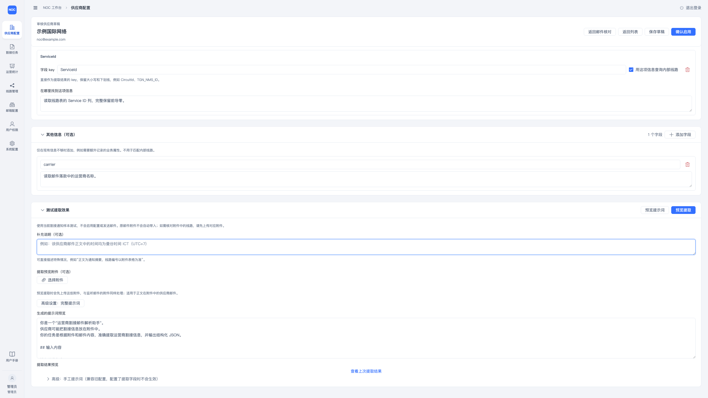

图 7-12：测试区域包含“补充说明（可选）”“提取预览附件”“预览提示词”“预览提取”和“高级设置：完整提示词”。

1. 在补充说明中描述跨字段的特殊要求，例如“邮件正文只有摘要，线路以附件表格为准”。字段专属要求优先写在对应字段，避免多处指令冲突。
2. 点击“选择附件”添加测试文件，检查文件名及数量。测试会上传所选文件，再和当前样本及可访问的来源附件一起识别。
3. 点击“预览提示词”生成当前完整规则，并展开提示词区域。生成预览只是查看规则，不调用识别，不保存配置。
4. “生成的提示词预览”为只读。要改变内容，应改固定规则、自定义字段或补充说明，再重新预览。
5. 点击“预览提取”执行一次识别，并回到邮件核对界面查看结果；“查看上次提取结果”返回已有结果，不表示重新测试。
6. 修改规则后重新识别，确认没有旧结果提示，再保存。

### 7.14 高级配置：旧版手工提示词

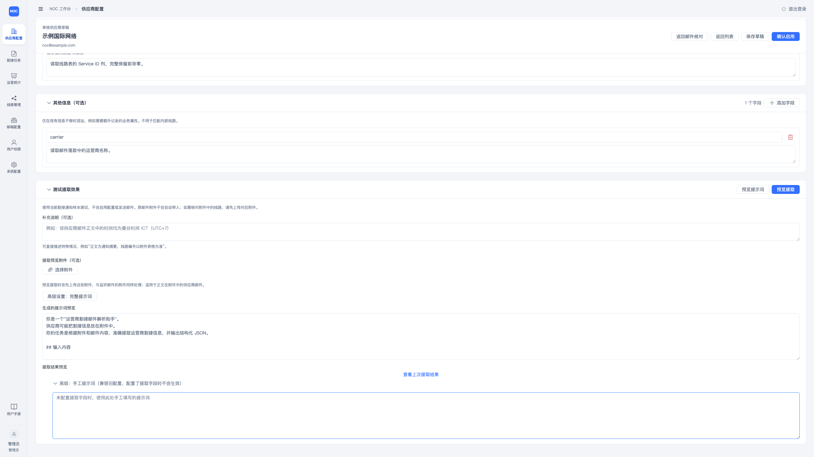

图 7-13：“高级：手工提示词”用于维护已有完整手写规则。手写规则与自动生成规则有不同生效条件，必须先判断当前模式。

| 当前配置 | 实际使用的规则 | 修改时注意 |
| --- | --- | --- |
| 有线路自定义字段 | 根据字段配置自动生成完整提示词 | 手工提示词不会作为主规则生效，修改字段和补充说明 |
| 无线路自定义字段且有手工提示词 | 使用完整手写提示词 | 在结果旁编辑规则时，应保留整份规则所需的输出结构 |
| 正式配置既无线路自定义字段，也无手工提示词 | 保存校验不通过 | 至少配置线路字段或提供完整手写规则 |

在手工模式下，“查看 / 编辑规则”编辑的是完整手写规则，不能误把整段替换成某一个字段的一句描述。添加线路字段后会切换到自动生成模式；切换后重新预览完整规则，确认旧规则的重要约束已迁移到相应字段/补充说明，再测试并保存。仅编辑高级固定规则而仍处于手工模式，不应认为这些覆盖项已经加入手写提示词。

### 7.15 草稿队列、审核提醒和启用记录

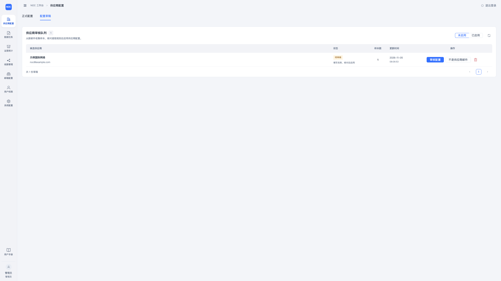

图 7-14：按状态筛选未启用草稿，查看样本数量、待办与错误。各状态对应的处理动作如下。

| 草稿状态 | 处理动作 |
| --- | --- |
| 收集样本中 | 等待有代表性的来信，查看已收集样本 |
| 生成中 | 等待后台完成，不重复触发 |
| 待审核 | 补全名称、对照样本、修正规则、测试后启用 |
| 生成失败 | 阅读错误原因，条件恢复后重试失败任务 |
| 已启用 | 查看历史依据；后续正式规则在正式配置维护 |

“AI 提醒您核对”通常关联某个字段、查询编号或样本。逐条检查，必要时修改识别方式并重测，再标记已确认；误确认时可重新打开。确认与当前样本、规则等上下文有关，修改内容后应重新检查提醒状态，不能把旧确认当作新配置已审核。

高级配置中的“生成依据”解释草稿从哪些邮件信息整理而来；已启用记录中的配置快照用于追溯，不应误认为它就是已被后续编辑更新的正式配置。

### 7.16 保存、启用、排除和删除的区别

| 动作 | 立即发生什么 | 后续影响 |
| --- | --- | --- |
| 应用规则修改 | 更新当前页面的规则 | 需测试并保存 |
| 保存草稿 | 保存待审核内容 | 不启用，不改变后续邮件正式处理规则 |
| 确认启用 | 经确认后建立/启用正式配置 | 后续新邮件使用正式规则，历史邮件不自动补上报 |
| 保存配置 | 更新已有正式规则 | 后续来信采用更新后的规则 |
| 删除草稿 | 删除草稿本身，按确认框说明保留相关内容 | 仍未配置且自动发现开启时，后续来信可能重新生成 |
| 不是供应商邮件 | 加入排除名单并移除该草稿，执行相关本地清理 | 后续该未配置发件人不再进入自动处理 |
| 删除正式供应商 | 移除正式规则及提取字段配置 | 后续处理取决于未配置供应商策略 |

“不是供应商邮件”与普通删除草稿不是同一动作。执行前仔细阅读确认框；当系统使用“仅处理指定发件人”等冲突策略时，排除操作可能被阻止，应先核对系统配置。不要用排除发件人代替修正一封识别错误的业务邮件。

排除发件人还会取消该来源尚未完成的分析任务，并清理本地该发件人的未配置供应商历史邮件及关联数据。涉及未获操作授权的邮箱、已有正式配置或执行冲突时会被阻止。与只删除草稿相比，这是影响范围更大的清理动作，应先核实历史业务是否仍需保留。

## 8. 维护线路台账

进入“线路管理”，按供应商、类型、状态或编号关键词查找线路。

新增或编辑时填写 Supplier、Supplier Circuit ID、Circuit ID、类型、线路状态与备注。Supplier 和 Supplier Circuit ID 为必填项；一个单元格内的多个编号使用换行分隔，保留实际编号的括号、空格等字符。

线路类型用于区分客户与骨干等业务；线路状态影响能否生成任务。不要为通过生成校验而把实际已拆机或无需上报的线路改成“正常”。

增量导入线路表的步骤：

1. 点击“下载模板”，在默认“线路表”页填写新增记录；“填写说明与示例”页不参与导入。
2. 保留六列表头，Supplier 和 Supplier Circuit ID 必填；编号使用文本格式，多个编号在同一单元格内换行。
3. 点击“增量导入”，选择 `.xlsx` 文件并“解析预览”，核对待新增、跳过、校验错误及待核对数量。
4. 修正所有校验错误后，点击“确认新增 N 条”。完成后可“下载结果明细”，按原始行号查看每条记录的结果和原因。

> 增量导入只新增，已有线路保留原值。全量覆盖位于导入按钮右侧的“更多导入方式”菜单，会替换整个台账，须再次确认。单条删除也不可恢复。

### 8.1 线路查询与字段含义

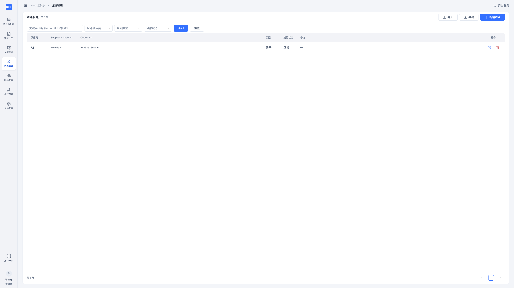

图 8-1：按供应商、类型、线路状态和关键字组合查询；“重置”清空筛选。关键字可匹配编号/Circuit ID/备注，列表底部切换页码及条数。核对线路时同时查看供应商编号与内部编号，避免同名或历史线路误绑定。

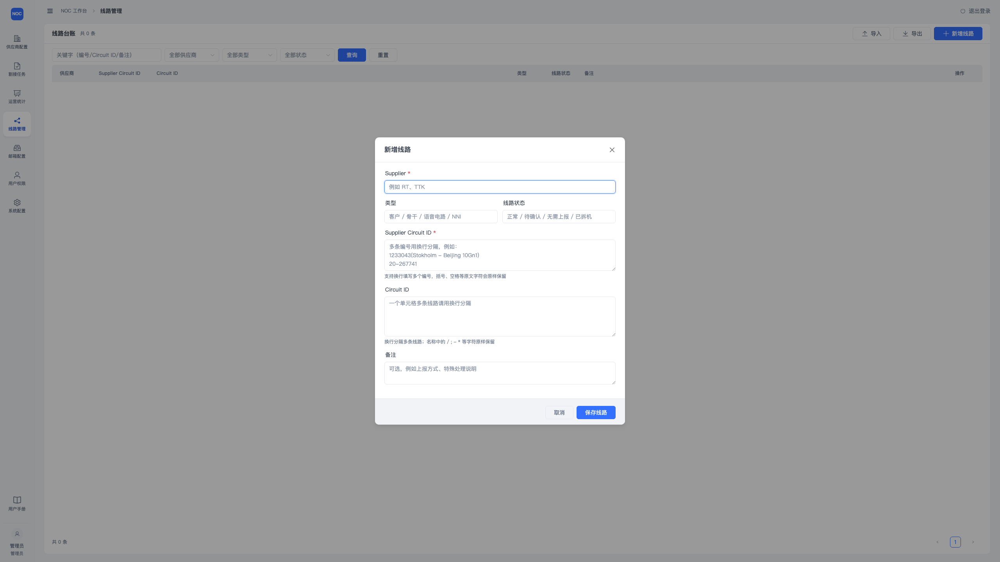

图 8-2：填写各字段后点击“保存线路”，等待成功提示及列表更新。取消则不写入本次输入。

| 字段 | 含义与使用方法 |
| --- | --- |
| Supplier | 线路所属供应商或运营商标识；必填 |
| Supplier Circuit ID | 对方使用的线路编号；必填，多值用换行分隔 |
| Circuit ID | 内部线路编号，匹配及填报时需要精确对应；多值按页面要求换行 |
| 类型 | 客户、骨干、语音电路、NNI 等业务类型，决定后续是否及如何生成任务 |
| 线路状态 | 正常、待确认、无需上报、已拆机等实际状态；非正常状态可能阻止任务生成 |
| 备注 | 特殊处理说明、补充归属或上报要求；供人工核对参考 |

### 8.2 增量导入、模板下载与全量覆盖

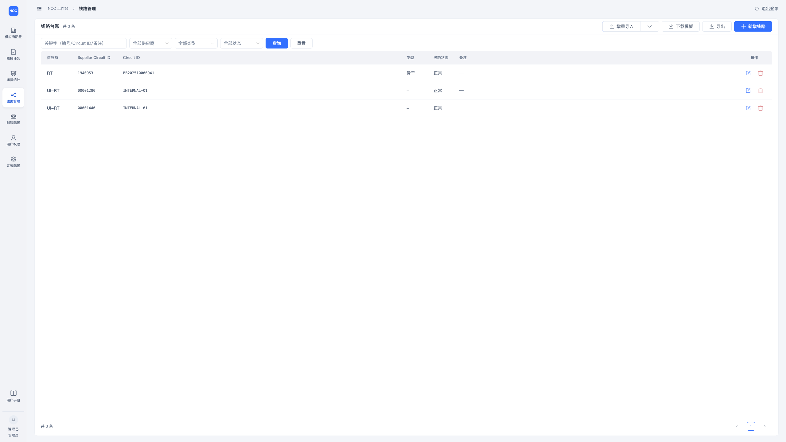

图 8-3：“增量导入”弹窗支持选择或拖入 `.xlsx` 文件，文件最大 10 MB、数据最多 10,000 行。“解析预览”不会写入数据。预览可筛选新增、跳过、错误及待核对记录；超过 50 条时分页展示。

系统按供应商和完整供应商线路编号去重，保留编号大小写、前导零、括号和空格。单元格含多个编号时按换行逐一核对；任一编号重合即整行跳过。系统已有记录即使状态或备注不同也不会更新，而会标明差异。文件内完全重复只处理第一条；同一编号内容冲突时，相关行全部跳过并标为待核对。

缺少必填值、公式、Excel 错误值或可能丢失精度的长数字编号会阻止整批写入，请修正后重新上传。Circuit ID 值、类型、线路状态和备注可空，空状态不自动改为“正常”。选择新文件会清除旧预览；预览超过 15 分钟或提交时相关数据已变化，系统要求重新核对，暂不写入。重复提交不会重复新增。

“下载模板”可在列表工具栏和导入弹窗内使用。模板保留六列表头，编号列预设文本格式，示例放在单独说明页。导入只读取名为“线路表”的工作表；旧文件没有该工作表时读取当前活动表。

需要替换整个台账时，从“更多导入方式”选择“全量覆盖导入”，上传完整清单，经预览和二次确认后覆盖。请先用“导出”留存现有数据；增量补充请使用默认的“增量导入”。

删除单条线路时，先看确认框中的线路标识；删除台账不等于撤销已生成任务或外部综调记录。修改台账后，已有邮件/任务也不会因此自动完成全部重新匹配和重生成。

## 9. 查看运营统计

1. 进入“运营统计”，选择本周、上周、本月或自定义日期范围。
2. 选择邮箱范围和测试 / 生产环境，点击“查询统计”。普通用户仅统计有“查看并操作”权限的邮箱。
3. 查看接收邮件、割接通知、上报邮件、上报工单、上报线路、回复邮件等指标及趋势。
4. 在运营商汇总中搜索、筛选和排序，点击上报数量进入相应业务明细，再通过“来源邮件”回到割接详情。
5. 需要汇总资料时，在运营商汇总中点击“导出筛选结果 CSV”。

统计日期按北京时间展示。邮件、工单和线路是不同统计单位，不能直接互相替代；核对差异时应同时确认日期、邮箱、环境和明细口径。

### 9.1 查询范围与指标口径

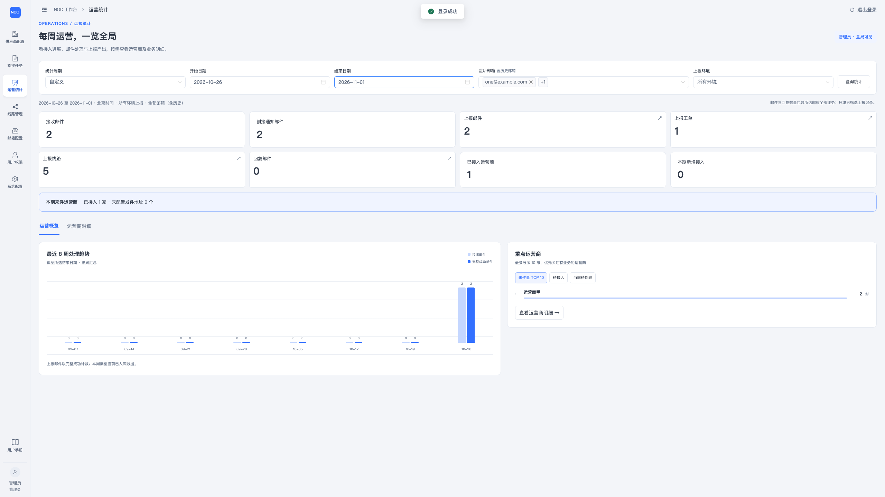

图 9-1：依次选择统计周期、开始/结束日期、监听邮箱、上报环境，点击“查询统计”。修改日期会转为自定义周期；起止日期必须完整且结束不早于开始。

邮箱多选框支持搜索、全选、清空。清空邮箱表示没有选择任何邮箱，不表示统计全部；管理员的“全部邮箱（含历史）”与只勾选当前监听邮箱范围不同。查询后查看页面的日期、时区、环境与邮箱范围摘要，汇总资料时一并注明。

“上报环境”只筛选上报记录，**接收邮件和回复数量仍包含所选邮箱的全部业务**。上报邮件以完整成功计数，部分任务成功不等于整封邮件完整成功。上报工单数、线路数和邮件数不能相互替代。

### 9.2 趋势和重点运营商

最近 8 周趋势展示截至所选结束日期的接收邮件和完整成功邮件；本周以已入库数据为准。重点运营商可切换“来件量 TOP 10”“待接入”“当前待处理”，最多显示 10 家；不是完整运营商清单。点击“查看运营商明细”进入相应筛选后的列表。

来件接入率及“已接入 / 未配置发件地址”用于发现仍需配置的来源。发现未配置发件人后，回到供应商草稿结合实际样本审核，不能仅按统计名称直接启用规则。

### 9.3 运营商明细、业务追溯与 CSV 导出

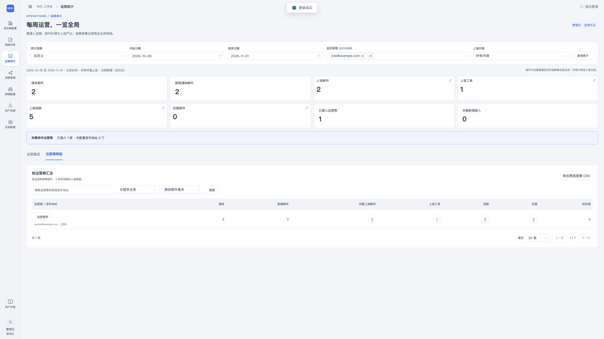

图 9-2：切换“运营商明细”后，可按名称或发件地址搜索，筛选“本期有业务 / 全部运营商 / 已接入 / 未配置发件方 / 当前待处理”，并按接收、上报、待处理或名称排序。

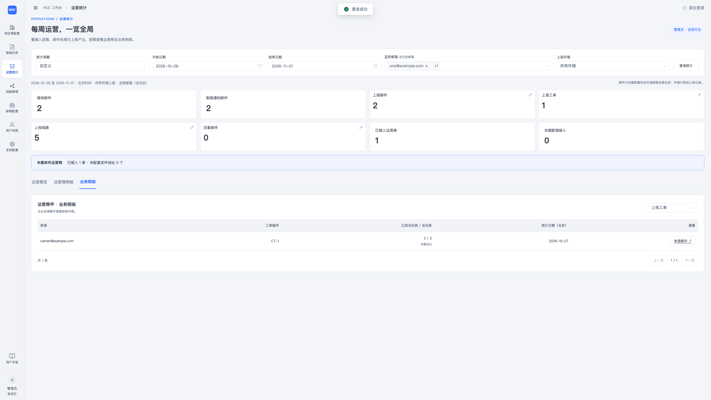

图 9-3：业务明细按当前统计范围展示可追溯记录，通过右侧来源邮件入口查看实际处理过程。

点击工单、线路、上报邮件或回复等可点击的数量，进入“业务明细”。选择明细类型，检查工单编号、线路编号、任务完成数、统计日期等；点击“来源邮件”回到业务详情核实。部分成功时，工单明细可能显示成功任务数小于总任务数。

“导出筛选结果 CSV”导出当前已应用的运营商查询范围；先点击搜索或应用筛选再导出，避免把尚未应用的输入当作导出条件。等待文件完成后，用支持 UTF-8 的表格软件打开。导出文件包含业务信息，按团队既定方式保存。

## 10. 管理邮箱与用户

本节操作使用管理员登录。

### 10.1 配置监听邮箱

1. 进入“邮箱配置”，点击“新增邮箱”。
2. 填写名称、邮箱地址、密码或授权码，以及 IMAP 服务器、端口和 SSL 配置。
3. 如需发送回复，填写正确的 SMTP 服务器、端口以及 SSL / STARTTLS 配置。
4. 点击“测试连接”，按反馈处理问题后保存，并检查列表中的监听状态和最后收件时间。

新增、修改、停用配置会即时生效，无需重启。编辑邮箱时，密码留空表示保持原密码。停用或删除邮箱会停止监听，操作前应确认值班安排。测试连接成功后，仍应检查实际监听与收件状态。

### 10.2 创建用户并分配权限

1. 进入“用户权限”，填写用户名、显示名称和初始密码（10–128 位），点击“创建账号”。
2. 选择用户，为每个邮箱设置“未授权”“仅查看”或“查看并操作”。
3. 点击“保存邮箱授权”。没有配置邮箱时，先到“邮箱配置”添加。
4. 请用户用个人账号登录，确认可见邮箱和可执行操作符合岗位需求。

账号停用或重置密码后，该用户的工作台登录立即失效。“解除综调绑定”用于处理该用户的综调绑定问题，执行前应确认其当前任务和会话情况。

### 10.3 邮箱列表、启停和连接状态

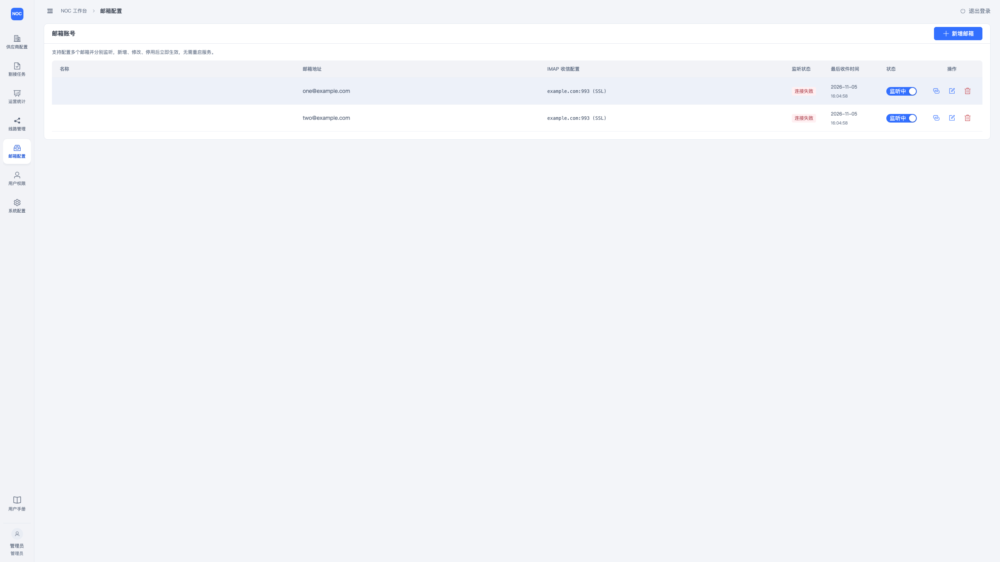

图 10-1：列表显示邮箱名称、地址、启用状态、监听状态及最后收件时间。启用状态是配置意图，监听状态是运行反馈，启用并不保证服务器连接成功。最后收件时间很旧时，结合是否确有新来信和连接状态排查，不要直接认定丢信。

停用邮箱保留配置但停止监听；重新启用后观察实际状态。删除邮箱配置会停止该邮箱监听，执行前核对现有用户授权、值班安排和业务依赖。

### 10.4 收信与发信参数逐项设置

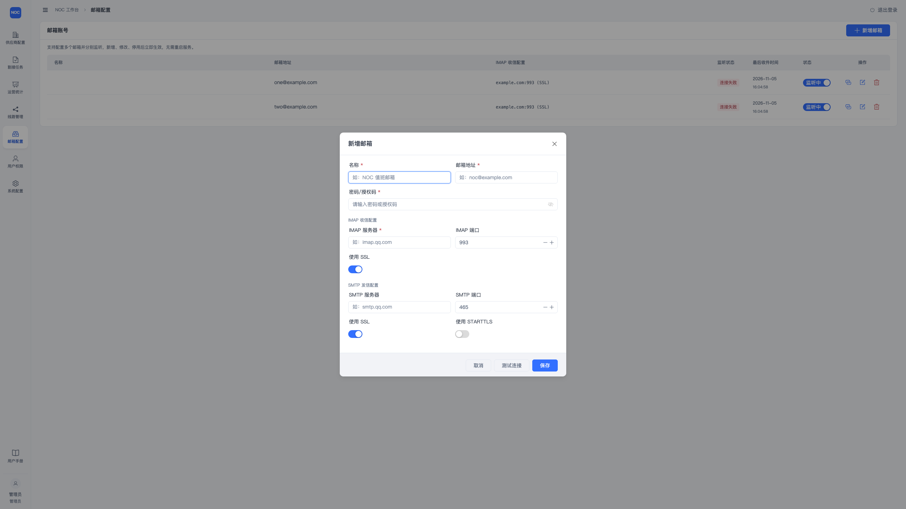

图 10-2：按邮箱服务商给出的连接参数填写，不根据相似邮箱猜测配置。

| 项目 | 填写与检查 |
| --- | --- |
| 名称 | 工作台里便于识别的值班邮箱名称 |
| 邮箱地址 | 完整邮箱地址，用于收件、权限范围及业务归属 |
| 密码/授权码 | 使用服务商要求的密码或专用授权码；编辑时留空保持原值 |
| IMAP 服务器、端口、SSL | 用于接收邮件；服务器名称、端口与加密方式必须配套 |
| SMTP 服务器、端口、SSL/STARTTLS | 用于发送回复；按服务商说明选择加密方式 |
| 启用状态 | 决定保存后是否参与监听 |

保存前“测试连接”使用当前表单值测试 IMAP；编辑时密码留空虽然可以保持原密码，但表单测试可能要求填写密码/授权码。列表的“测试连接”用于检查已保存配置。连接测试成功不等于 SMTP 发信也通过，也不能替代实际监听状态检查。

### 10.5 创建账号与逐邮箱授权

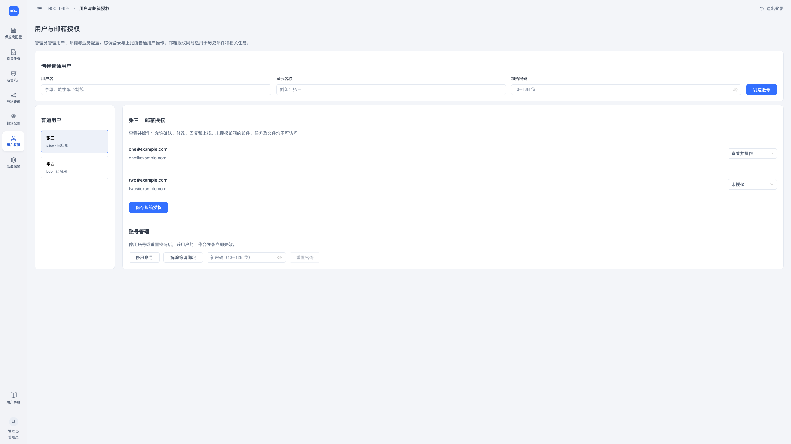

图 10-3：上方创建账号，下方左侧选择用户，右侧设置各邮箱权限。用户名使用界面规定的字母、数字、下划线格式，显示名称用于日常识别，初始密码长度 10–128 位。

创建后逐个邮箱选择权限并“保存邮箱授权”。“未授权”不可访问该邮箱及相关文件；“仅查看”可读不能改；“查看并操作”允许确认、修改、回复、删除及上报等操作。只创建账号但未授权邮箱，用户登录后可能看不到任何邮件。

修改授权后，让用户确认目标邮箱可见并能执行岗位需要的操作。权限也作用于历史数据，不只对授权后新来的邮件生效。

### 10.6 停用账号、重置密码与解除综调绑定

先在用户列表选中正确账号，再操作右侧“账号管理”：

1. “停用账号”阻止该用户继续使用工作台，并使现有工作台登录失效；需要恢复时选择“启用账号”。
2. “重置密码”先填写符合长度要求的新密码，再提交；重置后原登录失效，由用户使用新密码重新登录。
3. “解除综调绑定”用于处理该用户的综调绑定问题。执行前确认没有未核对的上报任务；如页面提示队列或会话仍被占用，先处理对应状态。

这些操作不能代替外部综调工单的核对或撤销。不要通过反复停用/启用账号来规避队列处理要求。

## 11. 调整系统配置

“系统配置”包含以下项目，修改共享配置前请与团队确认影响范围。

| 配置 | 操作说明 |
| --- | --- |
| 未配置供应商邮件处理 | 设置是否自动发现并生成草稿、是否分析割接通知时间，以及发件人范围；点击该区域的“保存设置” |
| 发件人范围 | 可全部处理、仅处理指定发件人或排除指定发件人；每行填写完整地址或 `*@example.com`，域名规则不包含子域名 |
| 重保时间（UTC+8） | 设置开始与结束时间并保存，按北京时间填写 |
| 骨干线路人员信息 | 填写 NOC 手机号、省公司审核人姓名和手机号，保存前需完整填写 |
| 界面语言 | 选择简体中文、English 或繁體中文（香港），立即生效并保存在当前浏览器 |

未配置供应商策略仅处理上线后新到达的邮件；正式供应商继续按已有规则处理。重保时间和骨干人员信息共用保存逻辑，保存重保时间时也需要完整的人员信息。

### 11.1 未配置供应商处理策略

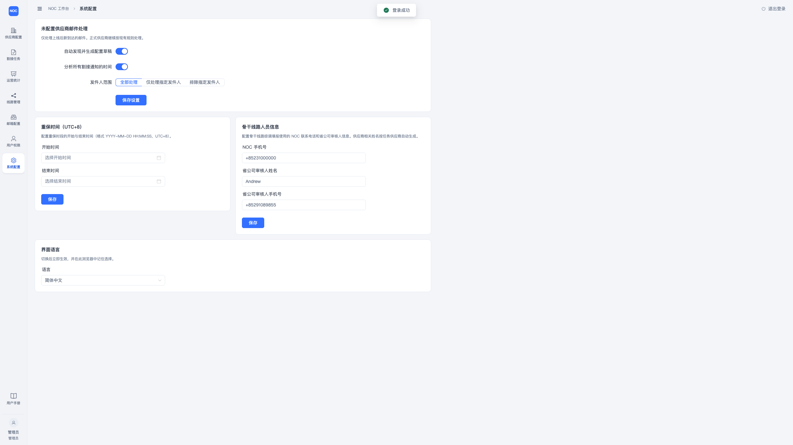

图 11-1：系统配置中的未配置供应商区域单独使用“保存设置”；重保时间和骨干人员区域使用“保存”，界面语言则即时生效。

“自动发现并生成配置草稿”负责从新来信整理候选供应商规则；“分析所有割接通知的时间”负责整体时间及场景分析，两项用途不同。关闭自动发现不等于已停止所有时间分析；按页面实际开关组合判断。

发件人范围三种模式：

| 模式 | 用法 | 检查点 |
| --- | --- | --- |
| 全部处理 | 处理符合流程的未配置来源 | 留意个人邮件或非供应商自动通知 |
| 仅处理指定发件人 | 每行配置一个邮箱或域名规则 | 目标发件人必须命中名单 |
| 排除指定发件人 | 名单中的来源不进入对应自动处理 | 不要误排除仍需值班处理的地址 |

`*@example.com` 只匹配该域名，不包含子域名。保存后检查回显模式和名单；设置主要作用于后续新到达的未配置邮件，不会自动回放所有历史来信，也不替代正式供应商规则。

### 11.2 重保窗口

填写开始和结束时间，按 UTC+8/北京时间理解，核对完整日期以免跨日填写错误。重保配置影响新处理邮件的场景判断；修改重保窗口不会自动撤销已发回复，也不会自动重判所有历史任务。

保存重保时间时，系统还会校验骨干人员信息是否完整。遇到人员信息必填提示，应补齐后保存，不要只检查时间控件。

### 11.3 骨干人员默认值

配置 NOC 手机号、省公司审核人姓名和手机号。保存后用于骨干填报的默认人员信息；供应商相关姓名由任务供应商生成。已有任务的表单内容仍需逐项检查，不能仅因系统配置已改就认为历史草稿自动同步完成。

### 11.4 界面语言

选择简体中文、English、繁體中文（香港）会立即改变界面文案，并在当前浏览器记住选择，不需要点击业务配置保存。语言切换不翻译原始邮件、线路编号或业务填写值。本手册使用简体中文文案说明操作，手册正文保持中文。

## 12. 常见问题

| 问题 | 建议处理 |
| --- | --- |
| 登录后看不到邮件 | 检查邮箱与筛选条件；联系管理员确认邮箱授权和监听状态 |
| 能看任务但不能操作 | 检查是否只有“仅查看”权限，或任务是否正在上报；根据页面提示处理 |
| 找不到综调会话或无法上报 | 确认使用普通用户账号，管理员 API Key 不提供个人综调上报 |
| 邮件已有识别结果，但没有任务 | 检查是否为未配置供应商、重复邮件、特殊规则或关闭场景，再检查线路匹配、状态及任务生成结果 |
| 改了识别结果，填报内容没变化 | 保存识别结果后，还需重新确认线路并重新生成任务，再核对和人工确认 |
| 已确认任务修改后不能直接上报 | 保存修改会回到待确认，需要重新人工确认 |
| 排队任务没有执行 | 检查前面的任务、手动暂停状态和会话是否有效；等待重新登录时使用原综调账号和环境恢复 |
| 服务重启后显示结果待核对 | 先到综调核实实际结果，再标记本地成功或失败，避免重复上报 |
| 已回复拒绝，仍存在上报任务 | 紧急或重保期场景可能保留任务；检查回复和上报两个流程 |
| 无法查看样本、附件或截图 | 确认来源邮箱权限、文件是否仍存在及登录是否有效，必要时联系管理员 |
| 邮箱连接失败 | 由管理员检查服务器、端口、加密方式、密码或授权码及网络连通性 |

删除邮件前，应明确删除范围：“删除邮件及关联数据”会永久清除本系统中的邮件、关联任务、分析结果、回复和上报记录，以及本地 EML、附件、Excel 和截图。供应商配置、线路主数据、原始邮箱中的邮件和外部综调记录保留。删除本地已上报记录不会撤销综调里的实际记录。

需要协助时，提供邮件记录 ID、任务 ID、操作时间、所在环境、页面错误提示和相关截图，方便管理员定位；不要在反馈中附带密码、API Key 或验证码。

手册通过工作台同一服务地址的 `/manual` 阅读。左侧目录按“入门、日常值班、配置与管理、帮助”分组；点击章节后，右侧“本章导航”显示该章的具体功能点，并随正文滚动高亮当前位置。左上角搜索框可搜索标题和正文，点击结果跳转到对应小节；Ctrl K / ⌘ K 聚焦搜索，向下方向键进入结果，Esc 清除搜索。也可用浏览器查找（Ctrl F / ⌘ F）定位全文。

### 12.1 删除邮件前的最后核对

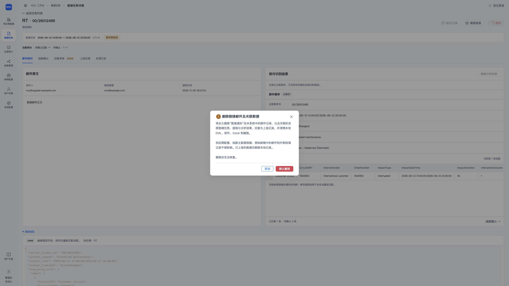

图 12-1：确认框中会列出删除范围与外部记录保留说明。示例仅打开确认框并取消，没有删除任何实际业务数据。

从列表行内删除图标或详情顶部“删除”进入确认框。先核对邮件主题和邮箱，再阅读关联删除范围。只有确认这条本地业务记录确实应移除时才继续；不确定时取消。

删除会清理本地关联任务、回复和上报记录及文件，后续将无法再通过这些本地记录追溯截图或表单。原始邮箱邮件及外部综调记录不会被撤销。如果有执行中的任务等冲突，按提示处理，不要反复点击绕过保护。

### 12.2 从错误提示判断下一步

| 提示/现象 | 先检查 | 下一步 |
| --- | --- | --- |
| 页面数据为空 | 账号、邮箱范围、筛选、日期 | 重置条件后重新查询；再核对权限 |
| 没有收到新邮件 | 邮箱是否启用、监听状态、最后收件时间 | 管理员测试 IMAP，核实实际来信 |
| 原文有值但识别为空 | 当前样本、附件、规则与上次结果提示 | 修正规则后重新识别，当前邮件另行修正 |
| 原始时间与任务时间不一致 | 原文时区、UTC 提取值与北京时间显示 | 按同一时区换算核对，避免二次转换 |
| 线路查询到了错误对象 | 原文编号、查询关键字、台账重复或旧数据 | 修正查询字段或明确人工绑定 |
| 保存配置失败 | 必填样本、重复 key、线路字段/手写规则 | 根据提示定位字段修正后再保存 |
| 草稿启用失败 | 名称、规则、权限或版本冲突提示 | 刷新核对最新内容，再尝试保存/启用 |
| 回复状态不明确 | 发件箱、收件地址、记录时间 | 先核实是否已发送，再决定重试 |
| 上报结果不明确 | 综调工单、任务号、线路及操作截图 | 人工核对本地结果，避免重复上报 |
| 附件打不开 | 文件是否仍存在、邮箱权限、格式支持 | 重试预览或下载原文件 |

### 12.3 操作影响速查

| 操作 | 会改变后续来信规则 | 会改变当前草稿/任务 | 会产生外部业务动作 |
| --- | --- | --- | --- |
| 供应商规则测试 | 否 | 只显示测试结果 | 调用识别服务，不发信、不上报 |
| 保存正式供应商配置 | 是 | 不自动重做历史任务 | 否 |
| 保存供应商草稿 | 否，启用后才生效 | 保存配置草稿 | 否 |
| 编辑当前邮件识别结果 | 否 | 保存识别并重新匹配，填报任务不自动覆盖 | 否 |
| 重新生成割接任务 | 否 | 覆盖已有填报内容并重置待确认 | 不撤销外部记录 |
| 保存填报修改 | 否 | 更新填报并回到待确认 | 否 |
| 人工确认任务 | 否 | 更新本地确认状态 | 不提交综调 |
| 确认发送回复 | 否 | 更新本地回复记录 | 发送邮件 |
| 上报综调系统 | 否 | 创建/跟进上报记录 | 队列执行时提交综调 |
| 核对后标记成功/失败 | 否 | 修正本地上报结果 | 不修改外部工单 |
| 删除邮件及关联数据 | 否 | 删除本地关联数据和文件 | 不删除原始邮箱或综调记录 |

### 12.4 问题反馈模板

反馈时填写：所在功能页、邮件记录 ID、任务 ID、邮箱、操作时间、测试/正式环境、预期结果、实际错误文案、已执行的核对与重试动作。附上对应界面截图，并遮挡无关业务信息。不要提供密码、API Key、手机验证码或包含会话凭证的文件。
